# 🧭 Futuraria MCP — Knowledge Graph & Tool Ecosystem

**Endpoint:** `https://design.futuraria.com/mcp`
**Protocol:** JSON-RPC 2.0 over SSE + HTTP POST
**Total tools:** 169
**Auth:** Public (initialize, tools/list, get_agent_guide, get_playbook) | x-api-key (everything else)
**Last updated:** 2026-07-25

---

## 1. Tool Catalog by Category

### 📋 Template CRUD (27 tools)
`create_template`, `create_deck`, `get_template`, `update_template`, `delete_template`, `duplicate_template`, `list_templates`, `rename_template`, `export_template`, `import_template`, `create_html_template`, `create_from_recipe`, `get_recipe`, `list_recipes`, `save_recipe`, `assemble_template`, `tag_template`, `untag_template`, `find_templates`, `get_file_meta`, `set_file_meta`, `upload_cover_image`, `get_design_artifacts`, `generate_design_artifacts`, `query_design_graph`, `update_thumbnail`, `profile_template_pool`

### 🖼️ Frame Management (11 tools)
`create_frame`, `list_frames`, `get_frame`, `delete_frame`, `duplicate_frame`, `create_html_frame`, `update_html_frame`, `delete_html_frame`, `get_html_frames`, `update_frame_content`, `get_frame_changes`

### ✏️ HTML/CSS Editing (8 tools)
`set_html`, `set_css`, `add_element`, `update_element`, `remove_element`, `reorder_element`, `add_primitive`, `set_frame_layers`, `set_canvas_layers`, `select_element`, `change_element_tag`, `hide_element`, `edit_text_content`, `list_all_texts`, `copy_style`, `paste_style`, `insert_icon`

### 🎨 Design System (10 tools)
`get_design_system`, `export_design_tokens`, `extract_design_system`, `verify_design_system`, `generate_brand_manual`, `get_design_artifacts`, `generate_design_artifacts`, `create_brand_guideline`, `update_brand_guideline`, `list_brand_guidelines`, `delete_brand_guideline`, `apply_brand_to_template`, `get_active_styles`, `set_style_lock`, `find_duplicate_styles`, `merge_brand_guidelines`, `download_style_template`

### 🏷️ Brand (6 tools)
`register_brand`, `validate_brand`, `check_contrast`, `check_accessibility`, `auto_fix_brand`, `get_brands`, `apply_brand`

### ✍️ Drawing/SVG (10 tools)
`draw_shape`, `draw_path`, `draw_bezier`, `transform_element`, `group_elements`, `align_elements`, `edit_path_points`, `edit_path_point`, `shape_to_path`, `pathfinder`, `set_stroke_style`, `set_gradient`, `set_blend_mode`, `outline_stroke`, `offset_path`

### 📦 Batch (3 tools)
`batch_render_html`, `generate_csv_template`, `apply_csv_to_frames`

### 📤 Export/Render (10 tools)
`export_template`, `export_batch`, `export_frame`, `export_pdf`, `copy_as`, `render_html_template`, `render_to_formats`, `render_batch`, `batch_render_html`

### 🔄 Format Adaptation (4 tools)
`detect_structure`, `adapt_format`, `adapt_all_formats`, `compare_adaptations`

### 🤝 Collaboration (6 tools)
`claim_section`, `release_section`, `get_active_agents`, `subscribe_template`, `unsubscribe_template`, `broadcast_section_change`, `share_template`

### 🕐 Versioning (4 tools)
`save_version`, `list_versions`, `restore_version`, `diff_versions`

### 🤖 AI Generation (6 tools)
`ai_generate_text`, `ai_generate_image`, `ai_palette`, `ai_suggest_layout`, `ai_translate`, `generate_from_prompt`, `enhance_template`, `image_to_design`, `generate_ui_components`

### 🔤 Fonts & Icons (5 tools)
`list_fonts`, `search_google_fonts`, `preview_font`, `add_font_to_template`, `get_font_details`, `search_icons`, `insert_icon`

### 🧰 Variables & Tokens (4 tools)
`create_variable`, `create_collection`, `link_variable`, `apply_variables`, `get_css_variables`, `set_css_variable`

### 📐 Layout (2 tools)
`smart_layout`, `suggest_color_palette`, `color_picker`

### 🏗️ Workspace (3 tools)
`list_workspaces`, `create_workspace`, `list_workspace_integrations`

### 🔑 Auth/Integrations (5 tools)
`create_api_key`, `revoke_api_key`, `list_api_keys`, `auth_token`, `call_workspace_mcp`

### 🧪 Analysis/Validation (8 tools)
`analyze_template_structure`, `extract_variables`, `lint_design`, `detect_structure`, `profile_template_pool`, `get_metrics`

### 🖼️ Assets (3 tools)
`list_assets`, `upload_image`, `delete_asset`, `optimize_image`, `replace_asset`, `search_stock_image`

### 📥 Import (2 tools)
`import_template`, `import_svg`

### ⚙️ Other
`register_tool`, `skill_clone`, `observe_session`

---

## 2. Mermaid Knowledge Graph

```mermaid
graph TB
    %% ── ENTRY POINTS ──
    subgraph Entry["🚪 Entry Points (No Auth)"]
        initialize["initialize<br/>Discover server info + playbook index"]
        tools_list["tools/list<br/>List 169 tools with schemas"]
        get_agent_guide["get_agent_guide<br/>Onboarding + key tools reference"]
        get_playbook["get_playbook<br/>Read playbook DAG by name"]
    end

    %% ── AUTH GATE ──
    initialize --> tools_list
    tools_list --> get_agent_guide
    get_agent_guide --> get_playbook

    AuthGate["🔐 tools/call<br/>Requires x-api-key header"] -->|validates| AllTools

    %% ── PLAYBOOKS ──
    subgraph Playbooks["📖 5 Playbooks"]
        replicate["replicate-html<br/>HTML+CSS → Frame → Multi-format"]
        from_scratch["create-from-scratch<br/>Description → Design → Adapt"]
        csv_batch_pb["csv-batch<br/>CSV → N Variant Frames"]
        design_sys_pb["design-system<br/>Extract tokens → Brand manual"]
        multi_agent_pb["multi-agent<br/>Agent → Section → Assemble"]
    end

    get_playbook --> Playbooks

    %% ── CORE DESIGN TOOLS ──
    subgraph Core["🏗️ Core Design Pipeline"]
        list_workspaces["list_workspaces"]
        create_template["create_template<br/>engine:'html' mandatory"]
        create_html_frame["create_html_frame<br/>Auto-positioned, never overlaps"]
        set_frame_layers["set_frame_layers<br/>RECOMMENDED: editable layers"]
        set_html["set_html<br/>Creative mode: raw HTML"]
        set_css["set_css<br/>Creative mode: raw CSS"]
        lint_design["lint_design<br/>Score 0-100, validation gate"]
        add_element["add_element<br/>One layer at a time"]
        add_primitive["add_primitive<br/>Circle/rect/text block"]
        update_frame_content["update_frame_content<br/>CSS selector surgery"]
    end

    replicate -->|Phase 2| create_template
    replicate -->|Phase 2| create_html_frame
    replicate -->|Phase 2| set_html
    replicate -->|Phase 2| set_css

    from_scratch -->|Phase 1| list_workspaces
    from_scratch -->|Phase 2| create_template
    from_scratch -->|Phase 2| create_html_frame
    from_scratch -->|Phase 2| set_frame_layers

    list_workspaces --> create_template
    create_template --> create_html_frame
    create_html_frame --> set_frame_layers
    create_html_frame --> set_html
    set_html --> set_css

    set_frame_layers --> lint_design
    set_html --> lint_design
    set_css --> lint_design

    %% ── DESIGN SYSTEM ──
    subgraph DesignSys["🎨 Design System Extraction"]
        get_design_system["get_design_system<br/>Read tokens + components"]
        get_design_artifacts["get_design_artifacts<br/>Tokens.json + DESIGN.md"]
        extract_design_system["extract_design_system<br/>Multi-template merge"]
        generate_design["generate_design_artifacts<br/>Publish to DB"]
        verify_design_system["verify_design_system<br/>Orphan/missing token check"]
        generate_brand_manual["generate_brand_manual<br/>Auto-generated HTML manual"]
        export_design_tokens["export_design_tokens<br/>DTCG JSON + CSS :root"]
    end

    design_sys_pb -->|Phase 1| get_design_system
    design_sys_pb -->|Phase 2| generate_design
    design_sys_pb -->|Phase 2| extract_design_system
    design_sys_pb -->|Phase 4| generate_brand_manual

    create_template --> get_design_system
    get_design_system --> extract_design_system
    extract_design_system --> verify_design_system
    generate_design --> generate_brand_manual

    %% ── BRAND ──
    subgraph Brand["🏷️ Brand Management"]
        register_brand["register_brand<br/>Colors + fonts + logo"]
        validate_brand["validate_brand<br/>Compliance score"]
        check_contrast["check_contrast<br/>WCAG ratios"]
        check_accessibility["check_accessibility<br/>A11y score"]
        auto_fix_brand["auto_fix_brand<br/>Auto-correct to brand"]
        apply_brand["apply_brand<br/>CSS vars injection"]
        get_brands["get_brands<br/>List saved brands"]
        create_brand_guideline["create_brand_guideline<br/>Store in DB"]
    end

    generate_brand_manual --> register_brand
    register_brand --> apply_brand
    apply_brand --> validate_brand
    validate_brand --> auto_fix_brand
    lint_design -.->|feeds| register_brand

    %% ── BATCH ──
    subgraph Batch["📦 CSV Batch Generation"]
        profile_template["profile_template_pool<br/>Detect content slots"]
        generate_csv["generate_csv_template<br/>Create CSV template"]
        apply_csv["apply_csv_to_frames<br/>Row → Frame"]
        batch_render["batch_render_html<br/>Export all variants"]
    end

    csv_batch_pb -->|Phase 1| profile_template
    csv_batch_pb -->|Phase 2| generate_csv
    csv_batch_pb -->|Phase 2| apply_csv
    csv_batch_pb -->|Phase 5| batch_render

    profile_template --> generate_csv
    generate_csv --> apply_csv
    apply_csv --> batch_render

    %% ── COLLABORATION ──
    subgraph Collab["🤝 Multi-Agent Collaboration"]
        claim_section["claim_section<br/>Lock frame (60s TTL)"]
        release_section["release_section<br/>Release lock"]
        get_active_agents["get_active_agents<br/>Who's editing what"]
        subscribe_template["subscribe_template<br/>Open realtime channel"]
        unsubscribe_template["unsubscribe_template<br/>Close channel"]
        broadcast_change["broadcast_section_change<br/>Notify peers"]
    end

    multi_agent_pb -->|Phase 2| claim_section
    multi_agent_pb -->|Phase 3| set_frame_layers
    multi_agent_pb -->|Phase 3| set_html
    multi_agent_pb -->|Phase 3| set_css
    multi_agent_pb -->|Phase 4| lint_design
    multi_agent_pb -->|Phase 4| broadcast_change
    multi_agent_pb -->|Phase 5| release_section

    claim_section --> set_frame_layers
    set_frame_layers --> lint_design
    lint_design --> broadcast_change
    broadcast_change --> release_section

    %% ── VERSIONING ──
    subgraph Versioning["🕐 Version History"]
        save_version["save_version<br/>Snapshot state"]
        list_versions["list_versions<br/>List snapshots"]
        restore_version["restore_version<br/>Rollback"]
        diff_versions["diff_versions<br/>Frame-by-frame diff"]
    end

    save_version --> list_versions
    list_versions --> diff_versions
    list_versions --> restore_version

    %% ── EXPORT ──
    subgraph Export["📤 Export & Render"]
        render_html["render_html_template<br/>PNG/WebP/JPG"]
        render_to_formats["render_to_formats<br/>Multi-format render"]
        export_template["export_template<br/>JSON backup"]
        export_frame["export_frame<br/>SVG/PDF export"]
        export_pdf["export_pdf<br/>PDF document"]
        copy_as["copy_as<br/>CSS/SVG/JSON code"]
        export_batch["export_batch<br/>Configurable presets"]
    end

    lint_design -->|pass| render_html
    render_html --> export_frame
    export_template -.-> import_template

    %% ── FORMAT ADAPTATION ──
    subgraph Format["🔄 Format Adaptation"]
        detect_structure["detect_structure<br/>Region detection"]
        adapt_format["adapt_format<br/>Single format"]
        adapt_all_formats["adapt_all_formats<br/>Multi format"]
        compare_adaptations["compare_adaptations<br/>Side by side"]
    end

    detect_structure --> adapt_format
    detect_structure --> adapt_all_formats
    adapt_all_formats --> compare_adaptations
    create_template --> detect_structure

    %% ── DRAWING / SVG ──
    subgraph Drawing["✍️ Drawing & SVG"]
        draw_shape["draw_shape<br/>Rect/circle/ellipse/line"]
        draw_bezier["draw_bezier<br/>Cubic/quadratic curves"]
        draw_path["draw_path<br/>SVG path data"]
        transform_element["transform_element<br/>Resize/reposition"]
        group_elements["group_elements<br/>Wrap in div"]
        align_elements["align_elements<br/>Left/center/right"]
        edit_path_points["edit_path_points<br/>Edit d-attribute"]
        shape_to_path["shape_to_path<br/>CSS → SVG path"]
        pathfinder["pathfinder<br/>Union/subtract/etc"]
        import_svg["import_svg<br/>SVG string → frame"]
        set_stroke["set_stroke_style<br/>Stroke properties"]
        set_gradient["set_gradient<br/>Linear/radial/conic"]
        set_blend["set_blend_mode<br/>mix-blend-mode"]
        outline_stroke["outline_stroke<br/>Stroke → filled path"]
        offset_path["offset_path<br/>Inset/outset path"]
    end

    %% ── FONTS & ICONS ──
    subgraph FontIcons["🔤 Fonts & Icons"]
        search_fonts["search_google_fonts<br/>94 Google Fonts"]
        add_font["add_font_to_template<br/>@import injection"]
        font_details["get_font_details<br/>Variants + subsets"]
        search_icons["search_icons<br/>1300+ Phosphor icons"]
        insert_icon_tool["insert_icon<br/>Phosphor icon in frame"]
        preview_font["preview_font<br/>Canvas preview"]
    end

    search_fonts --> add_font
    add_font --> font_details
    search_icons --> insert_icon_tool

    %% ── AI GENERATION ──
    subgraph AI["🤖 AI Generation"]
        ai_text["ai_generate_text<br/>GPT-4o-mini"]
        ai_image["ai_generate_image<br/>OpenRouter"]
        ai_palette["ai_palette<br/>5-7 color palette"]
        ai_layout["ai_suggest_layout<br/>Layout suggestions"]
        ai_translate["ai_translate<br/>Multi-language"]
        generate_from_prompt["generate_from_prompt<br/>HTML from text"]
        enhance_template["enhance_template<br/>Modify by instruction"]
        image_to_design["image_to_design<br/>Image → HTML/CSS"]
        generate_ui_components["generate_ui_components<br/>Button/card/nav etc"]
    end

    %% ── VARIABLES ──
    subgraph Variables["🧰 Variables & Tokens"]
        create_variable["create_variable<br/>Color/number/string"]
        create_collection["create_collection<br/>⚠️ Method not found"]
        link_variable["link_variable<br/>Bind to layer"]
        get_css_variables["get_css_variables<br/>Read CSS custom props"]
        set_css_variable["set_css_variable<br/>Set CSS var value"]
        apply_variables["apply_variables<br/>Batch replacements"]
    end

    %% ── UTILITIES ──
    subgraph Utils["🧰 Utilities"]
        color_picker["color_picker<br/>⚠️ param:color not hex"]
        suggest_palette["suggest_color_palette<br/>⚠️ param:baseColor not base"]
        smart_layout["smart_layout<br/>Grid/masonry/align"]
        search_stock["search_stock_image<br/>Unsplash/Pexels"]
        optimize_image["optimize_image<br/>WebP conversion"]
        upload_image["upload_image<br/>PNG/JPG/SVG/WebP"]
        get_metrics["get_metrics<br/>Daily activity stats"]
        tag_tool["tag_template<br/>Prefix:value format"]
        untag_tool["untag_template<br/>Remove tags"]
        find_by_tags["find_templates<br/>Tag search"]
        query_graph["query_design_graph<br/>Nodes + edges"]
    end

    %% ── AUTH / INTEGRATIONS ──
    subgraph Auth["🔑 Auth & Integrations"]
        list_api_keys["list_api_keys<br/>Masked display"]
        create_api_key["create_api_key<br/>Workspace-scoped"]
        revoke_api_key["revoke_api_key<br/>Immediate invalidate"]
        call_workspace_mcp["call_workspace_mcp<br/>BYOK MCP"]
        list_integrations["list_workspace_integrations<br/>Enabled connections"]
    end

    %% ── WORKSPACE ──
    subgraph Workspace["🏗️ Workspace"]
        list_workspaces["list_workspaces<br/>Find user workspaces"]
        create_workspace["create_workspace<br/>New workspace"]
        list_workspace_integrations["list_workspace_integrations"]
    end

    %% ── CONNECTIONS BETWEEN SUBSYSTEMS ──
    Core -->|"validation"| lint_design
    Core -->|"design tokens"| DesignSys
    Core -->|"brand enforcement"| Brand
    Core -->|"version history"| Versioning
    Core -->|"export"| Export
    Core -->|"format"| Format
    Core -->|"batch"| Batch
    Core -->|"collaboration"| Collab
    Core -->|"drawing"| Drawing
    Core -->|"fonts"| FontIcons
    Core -->|"AI"| AI
    Core -->|"variables"| Variables
    Core -->|"utilities"| Utils

    %% ── AUTH GATE ──
    Entry -.->|"public"| tools_list
    tools_list -.->|"public"| get_agent_guide
    get_agent_guide -.->|"public"| get_playbook
    get_playbook -.->|"public"| Playbooks
    Playbooks -.->|"🔐 tools/call"| Core

    %% ── STYLE ──
    classDef entry fill:#1a1a2e,stroke:#e94560,color:#eee,stroke-width:2px
    classDef playbook fill:#16213e,stroke:#0f3460,color:#eee
    classDef core fill:#0f3460,stroke:#533483,color:#eee
    classDef design fill:#533483,stroke:#e94560,color:#eee
    classDef batch fill:#1a3a3e,stroke:#00ff88,color:#eee
    classDef export fill:#2a1a3e,stroke:#ff8800,color:#eee
    classDef collab fill:#1a3a2e,stroke:#00aaff,color:#eee
    classDef utility fill:#2a2a3e,stroke:#888,color:#eee
    classDef auth fill:#3a1a1e,stroke:#ff4444,color:#eee

    class initialize,tools_list,get_agent_guide,get_playbook entry
    class replicate,from_scratch,csv_batch_pb,design_sys_pb,multi_agent_pb playbook
    class list_workspaces,create_template,create_html_frame,set_frame_layers,set_html,set_css,lint_design,add_element,add_primitive,update_frame_content core
    class get_design_system,get_design_artifacts,extract_design_system,generate_design,verify_design_system,generate_brand_manual,export_design_tokens,register_brand,validate_brand,check_contrast,check_accessibility,auto_fix_brand,apply_brand,get_brands,create_brand_guideline design
    class profile_template,generate_csv,apply_csv,batch_render batch
    class render_html,render_to_formats,export_template,export_frame,export_pdf,copy_as,export_batch export
    class claim_section,release_section,get_active_agents,subscribe_template,unsubscribe_template,broadcast_change collab
    class color_picker,suggest_palette,smart_layout,search_stock,optimize_image,upload_image,get_metrics,tag_tool,untag_tool,find_by_tags,query_graph utility
    class list_api_keys,create_api_key,revoke_api_key,call_workspace_mcp,list_integrations auth
```



---

## 3. Playbook-to-Tool Mapping

### replicate-html (Copy HTML+CSS → Frame → Multi-Format)
```
list_workspaces → create_workspace? → list_templates
→ get_template? → create_template → create_html_frame
→ set_html + set_css → lint_design
→ adapt_format / adapt_all_formats → render_html_template
```

### create-from-scratch (Build from description)
```
list_workspaces → list_templates
→ get_design_system? → create_template
→ create_html_frame → set_frame_layers
→ lint_design → export_design_tokens
→ adapt_format/s → render
```

### csv-batch (CSV → N Variants)
```
list_templates → profile_template_pool
→ generate_csv_template → claim_section
→ create_html_frame (per row) → set_frame_layers (per row)
→ lint_design (per row) → batch_render_html
→ release_section
```

### design-system (Extract → Brand Manual)
```
get_design_system → generate_design_artifacts
→ extract_design_system (multi-template)
→ generate_brand_manual → register_brand
→ validate_brand → generate_ui_components
```

### multi-agent (Collaborative Edit)
```
subscribe_template → claim_section (per agent)
→ set_frame_layers / set_html / set_css (parallel)
→ lint_design (per agent) → broadcast_section_change
→ release_section → assemble_template
→ unsubscribe_template
```

---

## 4. Public vs Auth-Gated

### Public (No API Key Needed)
| Tool | Purpose |
|------|---------|
| `initialize` | Discover server info, playbook index, capabilities |
| `tools/list` | List all 169 tools with input schemas |
| `get_agent_guide` | Onboarding guide, key tools, memory instructions |
| `get_playbook` | Read a playbook DAG by name |

### Auth-Gated (Requires x-api-key)
All other 165 tools. Key must be registered in `workspace_api_keys` Supabase table with format `fdr_ws_<base64url>`.

---

## 5. Common Pitfalls

| Pitfall | Details | Status |
|---------|---------|--------|
| **Auth wrong table** | `tools/call` validates against `workspace_api_keys` (not legacy `api_keys`) | ✅ Documented |
| **Key format** | Must be `fdr_ws_*` not `fd_*` | ✅ Documented |
| `color_picker` param | Uses `{ color }` not `{ hex }` (schema says hex) | 🐛 Bug |
| `suggest_color_palette` param | Uses `{ baseColor }` not `{ base }` (schema says base) | 🐛 Bug |
| `engine:'html'` mandatory | `create_template` requires `engine: 'html'` | ✅ Works |
| `get_template_structure` | Always returns 0 elements (reads template root, not frames) | 🐛 Bug |
| `set_frame_layers` response | Returns `{}` instead of `{ success, layerIds[] }` | 🐛 Bug |
| `duplicate_frame` frameId | Not deserialized correctly → "Frame not found: undefined" | 🐛 Bug |
| `insert_icon` crash | `.replace()` on undefined → internal error | 🐛 Bug |
| `create_collection` | Listed in schema but "Method not found" | 🐛 Bug |
| AI tools | Require `OPENROUTER_API_KEY` env var | ⚠️ Config |
| `search_stock_image` | Empty results (API key missing) | ⚠️ Config |

---

## 6. Workspace IDs Discovered

| Workspace | ID |
|-----------|----|
| Futuraria | `ws_1bd82c4e-1a3` |
| Content | `ws_650d12ad-a0b` |
| Demos | `ws_0e3002d1-c5a` |
| Beta & Tests | `ws_7b1c1bdb-1d8` |
| Futuraria Lab | `ws_c2ba06df-226` |
| Futuraria Design System | `ws_b55d1339-bfa` |
| Renzo's User WS | `ws_user_55facbd91fa0486281af` |

---

## 7. Auth Reality Check

```javascript
// How the MCP validates:
// 1. GET /mcp (SSE) + POST /mcp for { method: "initialize" | "tools/list" } → NO AUTH
// 2. POST /mcp for { method: "tools/call" } → REQUIRES x-api-key
// 3. checkAuth() in mcp.mjs:
//    - If MCP_ADMIN_KEY env set → apiKey must match it
//    - Else if bearer JWT from Supabase Auth → valid
//    - Else → validate against workspace_api_keys table by SHA-256 hash
//    - If no Supabase AND no MCP_ADMIN_KEY → dev mode (accept all)
```

---

*Document generated by Lara (OpenClaw) via systematic MCP discovery on 2026-07-25*
