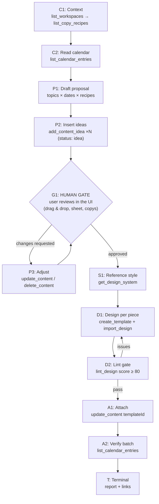

# GRAPH PLAYBOOK: Content Calendar — Propose → Approve → Design → Attach

> **Intent**: "Build me a content calendar proposal", "propose a month of posts and draft the copies", "OK, approved — now design everything using the style of this file".
> **Graph type**: DAG with a hard HUMAN GATE (propose → human approval → style extraction → design batch → attach → verify)
> **Agent scope**: IDE agent, Codex, Claude Cowork, Claude Code, Hermes, OpenClaw

---

## What this playbook is for

The user plans their social content in Futuraria's `content_calendar` table (one
row = one piece: date, topic, copy, channels, status, and — once designed — the
`templateId` of the piece's design). This playbook covers the full agency loop:

1. **You propose**: ideas with drafted copies, saved as calendar rows with
   status `idea`.
2. **The human approves**: they review in the UI (calendar, sheet, Copys pane),
   rearrange by drag & drop, edit, or tell you what to change.
3. **You design**: after explicit approval, extract the style from a reference
   design the human points at, then build one design per approved piece.
4. **You attach**: write each design's `templateId` back into its calendar row,
   so the human clicks one button in the sheet and lands in the editor.

The human gate is not optional. Proposing is free; designing is the expensive
step, and it only runs on approved rows.

## Schema

### Entity Types

| Type | Description | Key Fields |
|------|-------------|------------|
| `Objective` | The planning intent + period | `workspaceId`, `period`, `channelFocus?`, `referenceTemplateId?` |
| `Context` | What exists before proposing | `recipes[]`, `existingEntries[]`, `brands[]` |
| `Proposal` | A drafted batch of ideas | `items[]` (date, topic, draftCopy, channels, kind) |
| `Entry` | A `content_calendar` row | `id`, `scheduledDate`, `topic`, `copy`, `status`, `templateId?` |
| `Approval` | The human's verdict on the proposal | `approved[]`, `rejected[]`, `changes[]` |
| `Style` | Tokens extracted from the reference design | `colors[]`, `fonts[]`, `spacing`, `radius`, `cssRoot` |
| `Design` | One template built for one entry | `templateId`, `frameId`, `lintScore` |
| `Run` | Tool invocation | `tool`, `params`, `duration_ms`, `status` |
| `Evaluation` | Lint + attachment verification | `score`, `attachedCount`, `missing[]` |

### Relation Types

| Relation | From → To | Meaning |
|----------|-----------|---------|
| `USES_RECIPE` | Proposal → CopyRecipe | Draft copy written following this hook/tone/framework |
| `APPROVES` | Approval → Entry | Human green-lit this piece |
| `EXTRACTS_FROM` | Style → Design (reference) | Design tokens derived from this template |
| `DESIGNS` | Design → Entry | Template built for this calendar row |
| `ATTACHED_TO` | Design → Entry | `update_content` linked templateId ↔ row |
| `VALIDATES` | Evaluation → Design | Lint gate before attachment |

---

## Node Contract

```ts
interface CalendarNode {
  id: string;
  phase: "context" | "propose" | "gate" | "style" | "design" | "attach" | "terminal";
  tool: string | null;          // null on human phases
  params: Record<string, unknown>;
  expected: Record<string, unknown>;
  on_success: string;
  on_failure: string;
  max_retries: number;
  timeout_ms: number;
  // Calendar-specific
  requires_approval: boolean;   // nodes past the gate carry the approval id
  batch?: boolean;              // runs once per approved entry
}
```

---

## DAG: Propose → Approve → Design → Attach



---

## Phase C — Context

**C1 · Find the workspace and the voice.**

```
POST /mcp  {"method":"tools/call","params":{"name":"list_workspaces","arguments":{}}}
POST /mcp  {"method":"tools/call","params":{"name":"list_copy_recipes","arguments":{"type":"framework"}}}
POST /mcp  {"method":"tools/call","params":{"name":"list_copy_recipes","arguments":{"type":"hook"}}}
POST /mcp  {"method":"tools/call","params":{"name":"list_copy_recipes","arguments":{"type":"tono"}}}
```

The recipes ARE the user's voice: hooks for openings, `tono` for how they speak,
`framework` for structure (AIDA, PAS…). A proposal that ignores them is a
stranger's proposal. If the pantry is empty, ask the human if you should
research and store some first (`create_copy_recipe` with `source: "ia"`), or
draft without them.

**C2 · Read the existing calendar.**

```
POST /mcp  {"method":"tools/call","params":{"name":"list_calendar_entries","arguments":{
  "from": "2026-09-01", "to": "2026-09-30"
}}}
```

Don't propose over rows that already exist. Check pacing: how many pieces per
week, which channels, which days are taken.

**Gate C → P:** you know the workspace, have recipes (or their absence), and
know what's already scheduled.

## Phase P — Propose

**P1 · Draft the batch (no tools).** One line per piece:
`date · topic · hook used · draft copy · channels · kind`.

Rules of thumb:
- 3–5 pieces per week for organic; ads only if the human asked for them.
- Reuse 2–3 hooks across the month, not a new one per post.
- Draft copies are PROPOSALS: one or two sentences, written with the recipes,
  clearly marked as drafts in your reply.

**P2 · Insert each idea.**

```
POST /mcp  {"method":"tools/call","params":{"name":"add_content_idea","arguments":{
  "workspaceId": "ws_xxx",
  "scheduledDate": "2026-09-03",
  "topic": "Behind the scenes: how we print the posters",
  "copy": "Draft: Nadie ve esta parte del proceso. Hoy sí — mira cómo nace un póster nuestro, del boceto a la tinta.",
  "channels": ["instagram", "facebook"],
  "kind": "organic"
}}}
```

Every row lands with `status: "idea"` and lives in the same table the calendar,
the sheet and the reports read — so the human sees your proposal exactly where
their own ideas would be. The returned `_note` tells you the drafting path:
`list_copy_recipes → update_content`.

**Validation P:** call `list_calendar_entries({ status: "idea" })` and confirm
the count matches your draft. One missing row = a piece the human will never
see.

## Phase G — Human Gate (no tools)

Tell the human: *proposal ready — N pieces from DATE to DATE, review it in
Contenido → Calendario (drag any piece to another day) or Contenidos (edit the
sheet). Say "approved" (or tell me what to change) and I'll design everything.*

**P3 · Adjust on request** — `update_content` for edits (topic, copy, date,
channels), `delete_content` for rejected pieces. Then back to the gate.

**Gate G → S:** an explicit human approval in the conversation. "Diseña todo"
counts. Silence does not. Do not interpret status `aprobación` in the sheet as
approval on its own — the human must have told YOU.

## Phase S — Reference Style

The human says "extrae el estilo de tal archivo" and gives you a templateId
(you can `list_templates` to disambiguate by name).

```
POST /mcp  {"method":"tools/call","params":{"name":"get_design_system","arguments":{
  "templateId": "tpl_xxx"
}}}
```

Carry the tokens (colors, fonts, spacing, radius, `cssRoot`) into every design
of the batch. For a deeper extraction → brand manual path, switch to the
`design-system` playbook first and come back.

## Phase D — Design Batch (per approved entry)

For each approved row:

```
POST /mcp  {"method":"tools/call","params":{"name":"create_template","arguments":{
  "workspaceId": "ws_xxx", "name": "09-03 · Behind the scenes", "engine": "html"
}}}

POST /mcp  {"method":"tools/call","params":{"name":"import_design","arguments":{
  "templateId": "tpl_new",
  "document": "<!DOCTYPE html><html><head><style>/* tokens from get_design_system */ body{width:1080px;height:1350px;...}</style></head><body>…copy from the calendar row, re-laid-out for the format…</body></html>"
}}}

POST /mcp  {"method":"tools/call","params":{"name":"lint_design","arguments":{
  "templateId": "tpl_new"
}}}
```

- One design per entry; the calendar row's `copy` is the text of the piece —
  re-lay it out for the channel format (1080×1350 feed, 1080×1920 story, …).
- `lint_design` must reach **score ≥ 80** with no critical issues before you
  attach. Fix and re-lint; don't lower the bar to move on.
- Name templates with date + topic so the human recognizes them later.

## Phase A — Attach + Verify

**A1 · Link each design to its row.**

```
POST /mcp  {"method":"tools/call","params":{"name":"update_content","arguments":{
  "id": "cc_xxx",
  "templateId": "tpl_new",
  "status": "diseño"
}}}
```

Attaching before lint passes is how broken designs end up in production plans.

**A2 · Verify the batch.**

```
POST /mcp  {"method":"tools/call","params":{"name":"list_calendar_entries","arguments":{
  "from": "2026-09-01", "to": "2026-09-30", "status": "diseño"
}}}
```

Every approved row must carry a `templateId`. In the app's sheet, the Archivo
column now shows the ID and a ↗ button — one click opens the design in the
editor, so the human reviews visually without leaving the plan.

**Terminal:** report per piece — date, topic, `templateId`, lint score — and
offer the next step: publishing is Phase P, only on the human's explicit go.

---

## Phase P — Publish + Schedule (social, multi-account)

The loop doesn't have to end at "attached": once the human approves a piece,
you can push it to its real destinations exactly like the Contenidos dialog
does — same endpoints, same validation, same row locking. There is one
publish pipeline; these tools ride it, they don't reimplement it.

**P1 · See the real destinations.**

```
POST /mcp  {"method":"tools/call","params":{"name":"list_social_accounts","arguments":{
  "workspaceId": "ws_xxx"
}}}
```

Returns, per provider, the accounts (`id`, `platform`, `name`), the workspace
defaults and the per-brand defaults (`brandDefaultAccountIds`). Pass
`refresh: true` to pull the live list from the provider first (uses the
caller's own credentials, like the UI refresh).

**P2 · Publish or schedule with explicit accounts.**

```
POST /mcp  {"method":"tools/call","params":{"name":"publish_content","arguments":{
  "contentId": "cc_xxx",
  "mode": "schedule",
  "scheduledFor": "2026-09-10T09:00:00",
  "timezone": "America/Mexico_City",
  "accountIds": ["ig_main", "ig_qr", "x_main"]
}}}
```

Rules that keep you out of trouble:

- Two accounts of the same platform = two ids in `accountIds`. That is the
  multi-account feature, not a mistake.
- Omit `accountIds` to use the saved defaults (the entry brand's, else the
  workspace's). `contentType` post|story|reel — stories/reels need Zernio and
  a media URL (`externalUrl` on the row counts).
- The entry needs copy and must still be `borrador`/`error`. A retry replays
  the ORIGINAL destinations by design — to send the same piece elsewhere,
  duplicate the row instead of fighting the lock.
- `mode: "schedule"` needs a future instant (`YYYY-MM-DDTHH:MM:00` +
  IANA `timezone`); the provider schedules server-side, nothing wakes up
  locally.

**P3 · Save a brand's defaults (optional).**

```
POST /mcp  {"method":"tools/call","params":{"name":"set_publish_defaults","arguments":{
  "workspaceId": "ws_xxx", "provider": "buffer",
  "brandId": "brand_xxx", "accountIds": ["ig_main", "ig_qr"]
}}}
```

Per-brand MERGE: other brands keep their saved defaults, and `[]` clears this
brand's. Without `brandId` it sets the workspace default (one account per
platform, resolved from the cached list). Requires admin credentials — the
same rule the UI enforces.

`list_calendar_entries` also accepts `brandId` / `brandIds` (union across
brands) — the same multi-brand filter the Calendario UI has, so per-brand
plans read naturally.

---

## Error Recovery

| Failure | Symptom | Recovery |
|---|---|---|
| Auth rejected | 401 on tools/call | `verify_api_key({ apiKey })` (public) → fix header, don't create a new key |
| Calendar table missing | `content_calendar insert failed … supabase_migrations_v22.sql` | STOP. Tell the human to run v22 in Supabase and reload the schema |
| Recipes table missing | `_error` in `list_copy_recipes` result | Same: v32 must be executed; proposal can continue without recipes if the human accepts |
| Wrong row | `Content not found` | The id is from another workspace or was deleted — re-list and reconcile |
| Drop/link refused | 403 / editor required | The API key's role is viewer; the human must issue an editor key |
| Lint stuck | score < 80 after 2 fixes | Attach nothing; report the piece to the human with the issues |
| Batch partially attached | A2 shows missing ids | Re-run A1 only for the missing rows; never re-create designs that exist |

## Do / Don't

**Do**
- Read the recipes before drafting, and cite which ones you used.
- Keep every proposal row at `status: "idea"` until the human speaks.
- Batch-verify with `list_calendar_entries` — the sheet and the calendar must
  agree with what you did.
- Tell the human they can drag pieces across days in the calendar while
  reviewing your proposal.

**Don't**
- Never design pieces the human hasn't approved — that's the gate's whole job.
- Never set `programado` / `publicado` on your own; those are human/ops states.
- Never overwrite a row's `copy` after approval without saying so.
- Never attach a `templateId` whose lint score is below the gate.
