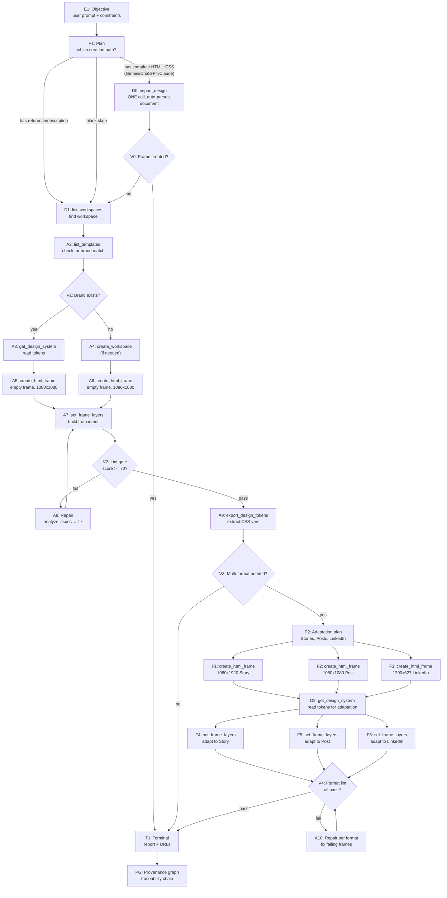

# GRAPH PLAYBOOK: Create Design from Scratch

> **Intent**: "Create a new design from scratch — I have an idea/description but no existing template."
> **Graph type**: DAG (design lineage + validation gates)
> **Agent scope**: IDE agent, Codex, Claude Cowork, Claude Code, Hermes, OpenClaw

---

## 0 · Cómo diseña un humano (secuencia obligatoria)

> Esta es la sección que se afina a mano. Todo lo de abajo es el esquema
> técnico del grafo; esto es **el criterio de diseño** que el agente debe
> seguir. Si el resultado no tiene la calidad esperada, casi siempre es
> porque se saltó un paso de acá.

Un diseño no es "escribir HTML". Es esta secuencia, en este orden:

1. **Creá el frame.** Nunca diseñes sobre un frame ajeno salvo que el humano
   nombre uno específico.
2. **Pintá el fondo** con el color pedido. Si el humano dice "blanco" o
   "transparente", el fondo es `#FFFFFF` — no lo dejes sin color.
3. **Armá las figuras con primitivas primero**: rectángulo y triángulo cubren
   la mayoría.
4. **Si la figura es compleja, descomponéla en la mayor cantidad de
   rectángulos posible.** Que se superpongan no es un problema — es
   preferible. No intentes resolverla de una sola pieza.
5. **Usá pluma/bezier sólo para lo que no se puede hacer con primitivas** —
   el resto de la silueta.
6. **Seleccioná todo y usá el buscatrazos (pathfinder)** para fusionar o
   cortar hasta obtener la forma final.
7. **Recién ahí aplicá** color de relleno, stroke, color de stroke y bordes.
8. **Colocá las fotos**, acomodá tamaños, stroke, color de stroke y bordes.
9. **Colocá los textos.**
10. **Acomodá el orden en z** al final, cuando ya sabés qué tapa a qué.

**Regla:** no saltes del paso 1 al 9. Un diseño que es sólo un fondo y texto
encima casi siempre significa que se omitieron los pasos 3–8.

---

## 0.1 · Modelo de datos: qué significa cada id

Antes de ejecutar nada, resolvé estas entidades. Confundirlas es la causa
más común de trabajo perdido o creado en el lugar equivocado.

| Entidad | Qué es | Regla que no se rompe |
|---|---|---|
| `usuario_id` | Id único de la cuenta | — |
| `workspace_id` | Id único del workspace propio | Nunca igual a `usuario_id` |
| `usuario_invitado_id` | Id de alguien que invité a mi workspace | — |
| `workspace_donde_soy_invitado` | Lista de workspaces ajenos donde tengo acceso | **Nunca** igual a mi `workspace_id` |
| `workspace_actual` | Desde dónde el humano manda la orden | Puede ser propio o invitado |
| `workspace_donde_disenar` | Dónde el humano quiere el diseño | **No siempre es `workspace_actual`** |
| `marca_id` | Cada workspace tiene marcas; cada marca tiene id | Nunca igual a `usuario_id` ni `workspace_id` |
| `estilo_id` | Cada marca puede tener varios estilos | Si una marca no tiene estilos, aún no automatiza |
| `archivo_id` | Un workspace tiene varios archivos; un archivo tiene varios frames | **Todos los diseños de un mismo pedido van al mismo archivo**, salvo que el humano diga lo contrario |
| `frame_id` | Cada frame vive dentro de un archivo | **Cada pedido de diseño = un frame nuevo**, salvo que nombre uno existente |

---

## 0.2 · Medidas del frame

Las medidas son libres, pero elegí según la plataforma y el caso de uso que
mencione el humano. **Ante la duda, validá con él antes de crear.**

| Contenido | Medidas (px) | Relación |
|---|---|---|
| Foto de perfil | 320 × 320 | 1:1 (se ve en círculo) |
| Post cuadrado (feed) | 1080 × 1080 | 1:1 |
| Post horizontal (feed) | 1080 × 566–608 | 1.91:1 |
| Post vertical clásico | 1080 × 1350 | 4:5 |
| Post vertical nuevo | 1080 × 1440 | 3:4 |
| Carrusel | 1080 × 1080 ó 1080 × 1350 | 1:1 / 4:5 |
| Stories | 1080 × 1920 | 9:16 |
| Reels | 1080 × 1920 | 9:16 |
| Portada de destacadas | 640 × 640 | 1:1 |
| Portada de Reel | 420 × 654 | 1:1.55 |
| Reels ultra anchos | 5120 × 1080 | 5:1 |

Si el humano dice "post" sin más, lo más probable es 1080×1080 — pero
confirmá. Si dice "presentación", es un slide horizontal.

---

## 0.3 · Resolución de estilo (cascada, en este orden)

El sistema guarda estilos con nombre, id, artefactos y al menos una plantilla
fuente resolvible. La identidad es única dentro de cada workspace por nombre
normalizado: `trim`, espacios repetidos colapsados y minúsculas. Esa
normalización es para igualdad exacta; **no elimina prefijos ni sufijos**.

Cuando el humano pide "estilo X":

1. **Biblioteca del workspace actual** — buscá una coincidencia exacta del
   nombre normalizado. Antes de usarla, comprobá que conserve al menos un
   `sourceTemplateId` resolvible del mismo workspace.
2. **Candidatos** — coincidencias por prefijo, sufijo o similitud son solo
   sugerencias. Mostralas y esperá confirmación; nunca elijas una por tu cuenta.
3. **Archivos del workspace** — si no existe el estilo, podés proponer un
   archivo como referencia. Solo después de que el humano lo confirme se
   extrae y crea el estilo de forma atómica: artefactos, registro y asociación
   con la plantilla fuente se guardan juntos o no se guarda nada.
4. **Otros workspaces** — pueden aportar candidatos si el humano tiene acceso,
   pero no cuentan como referencia válida hasta copiar/crear la referencia en
   el workspace destino con autorización explícita.
5. **Si no existe o está huérfano/inválido** — devolvé
   `blocked -> style_not_found` o `blocked -> style_invalid` y preguntá a cuál
   se refiere. **No inventes el estilo, no uses estilo libre y no generes un
   diseño blanco como fallback.**

`create_brand_guideline` directo o renombrar hacia un nombre normalizado ya
ocupado falla con conflicto. La recaptura mediante
`generate_design_artifacts(action="publish")` es la excepción deliberada: si el
humano escribió o confirmó un nombre que coincide exactamente después de
normalizar, actualiza el único registro canónico con ese nombre. El CRUD directo
de update/rename sigue operando por ID. Los fingerprints visuales sugieren
candidatos de merge, pero el merge siempre requiere confirmación y nunca ocurre
automáticamente.

Todo estilo debe conservar una plantilla fuente válida. Una actualización no
puede vaciar `sourceTemplateIds`; borrar la última plantilla fuente elimina el
estilo en la misma operación. Eliminar un estilo requiere confirmación y limpia
su lock y asociaciones.

Si el humano **no menciona** estilo: usá el estilo de su marca. Si su marca
todavía no tiene estilo, usá estilo libre.
Si el humano dice **"sin estilos"**: estilo libre, no busques nada.

---

## 0.4 · Tema

El tema es de qué habla el contenido. Los temas **no se guardan** — se
investigan y redactan por pedido.

- El humano da sólo el tema → investigás, redactás, después diseñás.
- El humano da tema **y** textos → diseñás directamente con esos textos.

---

## 0.5 · Ejemplos resueltos

**"Crea un post que diga hola renzo 5 en un archivo nuevo sin estilos"**
→ En este workspace · archivo **nuevo** (id nuevo) · un frame ·
probablemente 1080×1080 (validar) · estilo **libre** porque dice "sin
estilos" · el texto dice exactamente `hola renzo 5`.

**"Busca en el archivo Jockey demo el template o frame llamado Disc 5, duplicalo y hazlo en versión light"**
→ Empezá por este workspace · listá **todos** los archivos y buscá uno que
matchee "Jockey demo" (las palabras pueden estar en cualquier orden) · si no
aparece, repetí en los workspaces donde el humano es invitado · si tampoco,
**pará y pedí el enlace** · con el enlace confirmá que tenés acceso; si no lo
tenés, decílo y pedíselo · recién entonces duplicá el frame y hacé la
variante light.

---

## Schema

### Entity Types

| Type | Description | Key Fields |
|------|-------------|------------|
| `Objective` | User intent + constraints | `description`, `targetFormats`, `brandName` (optional) |
| `Plan` | Tool sequence branching based on context | `steps[]`, `validationGate`, `fallback` |
| `Artifact` | Design output produced by a tool | `templateId`, `frameId`, `layerIds[]`, `sourceHash` |
| `Run` | Single tool invocation | `tool`, `params`, `duration_ms`, `status` |
| `Evaluation` | Validation gate verdict | `score`, `issues[]`, `pass/fail` |
| `Claim` | Lock on a frame (multi-agent) | `agentId`, `frameId`, `expiresAt` |
| `Source` | Input reference (prompt, brand guide, image) | `type`, `content`, `provenance` |

### Relation Types

| Relation | From → To | Meaning |
|----------|-----------|---------|
| `HAS_PLAN` | Objective → Plan | This objective follows this plan |
| `PRODUCED` | Run → Artifact | Run created this artifact |
| `EVALUATES` | Evaluation → Artifact | This gate validates this artifact |
| `PARENT_OF` | Artifact → Artifact | Adaptation/derivative |
| `DEPENDS_ON` | Artifact → Artifact | Must exist before this can be created |
| `CLAIMS` | Claim → Artifact | This agent holds the lock |
| `VALIDATES_AGAINST` | Evaluation → Plan | Gate maps to plan validation contract |

---

## Node Contract (TypeScript Interface)

```ts
interface ScratchNode {
  id: string;
  phase: "intent" | "discovery" | "creation" | "validation" | "adaptation" | "terminal";
  tool: string | null;
  params: Record<string, unknown>;
  expected: Record<string, unknown>;  // shape of expected output
  on_success: string;                 // next node id
  on_failure: string;                 // error recovery node id
  max_retries: number;
  timeout_ms: number;
  contract: string;                   // validation contract id (V1-V5)
}
```

---

## DAG: Create Design from Scratch



---

## Phase-by-Phase Node Guide

### Phase 1: Intent → Discovery

| Node | Tool | Params | Expected Output |
|------|------|--------|-----------------|
| D1 | `tools/list` | `{}` | Available tools, server version |
| D1 | `list_workspaces` | `{}` | `[{ id, name, owner_id }]` |
| A2 | `list_templates` | `{ workspaceId }` | `[{ id, name, engine, frames }]` |
| V1 | — | Manual check | Does any template share brandName? |
| A3 | `get_design_system` | `{ templateId }` | `{ tokens, components, frames, brand, cssRoot }` |
| A4 | `create_workspace` | `{ name }` | `{ workspaceId }` |

**Branch logic**:
- If user provides **complete HTML+CSS document** (from Gemini, ChatGPT, Claude, etc.) → `import_design({ templateId, document })` — ONE call, auto-parses, returns frameId. Skip to Terminal.
- If `brandName` provided AND matching template exists → branch A3 (inherit design system)
- If `brandName` provided AND no match → branch A4 (create fresh, register brand later)
- If no `brandName` → branch A4 (blank canvas)

### Phase 2: Frame Creation

| Node | Tool | Params | Expected Output |
|------|------|--------|-----------------|
| D0 | `import_design` | `{ templateId, document: "<complete HTML from Gemini>" }` — OR `{ templateId, html: "...", css: "..." }` | `{ templateId, frameId, htmlLength, cssLength, detectedWidth, detectedHeight, mode: "created" }` |
| A5/A6 | `create_html_frame` | `{ templateId, name, width: 1080, height: 1080 }` | `{ frameId, x, y }` |
| A7 | `set_frame_layers` | `{ templateId, frameId, layers, fontImports? }` | `{ success, layerIds[] }` |

**`set_frame_layers` layer schema**:
```ts
interface EditableLayer {
  id: string;           // unique id within frame
  name: string;         // semantic name
  kind: "text" | "image" | "shape" | "container";
  position: { left: number; top: number };
  size: { width: number; height: number };
  // text-specific
  text?: string;
  fontFamily?: string;
  fontSize?: number;
  color?: string;
  fontWeight?: number;
  // image-specific
  src?: string;
  // shape-specific
  backgroundColor?: string;
  borderRadius?: number;
  boxShadow?: string;
  // container
  children?: EditableLayer[];
}
```

**Positioning**:
- First frame: `computeFramePosition(existing=[], …)` → `{ x: 0, y: 0 }`
- Subsequent frames: auto-placed by `create_html_frame` using cascade algorithm (max row width 4000px, 100px gap)
- Override with `update_html_frame` `{ x, y }` if manual placement needed

### Phase 3: Validation Gates

| Gate | Contract | Tool | Threshold | On Fail |
|------|----------|------|-----------|---------|
| V1 | Brand detection | Manual check | — | Proceed without brand |
| V2 | Lint gate | `lint_design` | `score >= 70` | A8: Read issues → apply fixes → re-lint |
| V3 | Multi-format | Manual check | User intent | Branch to adaptation OR terminal |
| V4 | Format lint | `lint_design` per frame | `score >= 70` | A10: Repair per failing frame |

### Phase 4: Adaptation (Conditional)

| Node | Tool | Params | Expected Output |
|------|------|--------|-----------------|
| F1 | `create_html_frame` | `{ templateId, name: "IG Story", width: 1080, height: 1920 }` | `{ frameId, x, y }` |
| F2 | `create_html_frame` | `{ templateId, name: "IG Post", width: 1080, height: 1080 }` | `{ frameId, x, y }` |
| F3 | `create_html_frame` | `{ templateId, name: "LinkedIn", width: 1200, height: 627 }` | `{ frameId, x, y }` |
| D2 | `get_design_system` | `{ templateId }` | Design tokens for consistent styling |
| F4-F6 | `set_frame_layers` | `{ templateId, frameId, layers }` | `{ success, layerIds[] }` |

**Adaptation constraints**:
- Maintain color palette (from design system)
- Maintain font hierarchy (from design system)
- Adjust layout to fit new aspect ratio
- Re-scale images proportionally
- Reposition CTAs for new dimensions

### Phase 5: Terminal Report

```ts
interface ScratchReport {
  objective: string;
  templateId: string;
  templateName: string;
  editorUrl: string;          // https://design.futuraria.com/?template={id}&v=2
  frames: {
    id: string;
    name: string;
    width: number;
    height: number;
    format: "square" | "story" | "linkedin" | "banner" | "custom";
    layerCount: number;
    lintScore: number | null;
  }[];
  designTokens?: {
    colors: number;
    fonts: number;
    components: number;
  };
  sourceHash?: string;
  generatedAt: string;
}
```

---

## Validation Contracts

### V1: Brand Detection
```yaml
check: |
  If brandName in intent:
    Scan list_templates result for name match
    If match → use get_design_system on that template
    If no match → proceed without brand (will use defaults)
on_fail: proceed_without_brand
```

### V2: Lint Gate
```yaml
check: |
  lint_design({ templateId, frameId })
  assert: score >= 70
  assert: no critical issues (severity === "error")
on_fail: |
  1. Parse issues[] from lint_design response
  2. For each issue: identify fix (CSS adjustment, layer reposition, font import)
  3. Apply fixes via set_frame_layers or update_html_frame
  4. Re-run lint_design
  max_retries: 3
```

### V3: Multi-Format Decision
```yaml
check: |
  User explicitly asked for multiple formats?
  OR template serves social media use case?
on_fail: skip_adaptation → terminal
```

### V4: Format Lint
```yaml
check: |
  For each adaptation frame:
    lint_design({ templateId, frameId })
    assert: score >= 70
    assert: no layout breakage from aspect ratio change
on_fail: |
  1. Identify failing frames only
  2. Repair each independently (parallel safe)
  3. Re-lint
  max_retries: 2 per frame
```

---

## Error Recovery Paths

### ER1: Workspace Not Found
```
Symptom: list_workspaces returns empty or error
Recovery:
  1. create_workspace({ name: "Scratch Workspace" })
  2. Store workspaceId
  3. Retry list_templates with new workspaceId
```

### ER2: Frame Creation Fails
```
Symptom: create_html_frame returns error
Recovery:
  1. Check template exists and engine === "html"
  2. If template missing: create_template first
  3. If engine mismatch: update_template({ engine: "html" })
  4. Retry create_html_frame
```

### ER3: set_frame_layers Rejected
```
Symptom: _editability.errors present in response
Recovery:
  1. Read errors[] (identifies which layers violate flat editability contract)
  2. Fix: remove nested containers, flatten groups, add explicit position to each layer
  3. Retry set_frame_layers
```

### ER4: Font Not Available
```
Symptom: fontImports URL invalid or font not rendering
Recovery:
  1. Use system-ui fallback in set_frame_layers fontFamily
  2. OR: search Google Fonts for nearest match
  3. Update fontImports with valid CDN URL
  4. Retry set_frame_layers
```

---

## Ratchet Loop (per frame)

```
while frame.lintScore < 70:
  issues = lint_design(templateId, frameId)
  if no issues: break
  for each issue:
    fix = generateFix(issue, frame)
    set_frame_layers(templateId, frameId, fix.layers)
  newScore = lint_design(templateId, frameId)
  if newScore <= frame.lintScore: break  // no improvement
  frame.lintScore = newScore
```

**Ratchet principle**: Only keep changes that improve the score. Revert if score drops.

---

## Agent Quick-Start (Copy-Paste)

### If you have complete HTML+CSS from Gemini/ChatGPT/Claude:
```json
{ "method": "tools/call", "params": { "name": "import_design", "arguments": { "templateId": "tpl_...", "document": "<!DOCTYPE html>..." } } }
```
→ Single call. Auto-parses <style>, <body>, font imports. Returns frameId. Done.

### If you're building from a description (no existing HTML):

### Step 1: Discovery
```json
{ "method": "tools/list" }
{ "method": "tools/call", "params": { "name": "list_workspaces" } }
```

### Step 2: Create Template
```json
{ "method": "tools/call", "params": { "name": "create_template", "arguments": { "workspaceId": "ws_...", "name": "My Design", "width": 1080, "height": 1080, "engine": "html" } } }
```

### Step 3: Create Frame
```json
{ "method": "tools/call", "params": { "name": "create_html_frame", "arguments": { "templateId": "tpl_...", "name": "Main Square", "width": 1080, "height": 1080 } } }
```

### Step 4: Build Layers
```json
{ "method": "tools/call", "params": { "name": "set_frame_layers", "arguments": { "templateId": "tpl_...", "frameId": "frm_...", "layers": [ { "id": "h1", "name": "Heading", "kind": "text", "position": { "left": 100, "top": 80 }, "size": { "width": 880, "height": 120 }, "text": "Hello World", "fontFamily": "Inter, sans-serif", "fontSize": 64, "fontWeight": 700, "color": "#1a1a2e" } ], "fontImports": ["https://fonts.googleapis.com/css2?family=Inter:wght@400;600;700"] } } }
```

### Step 5: Validate
```json
{ "method": "tools/call", "params": { "name": "lint_design", "arguments": { "templateId": "tpl_...", "frameId": "frm_..." } } }
```

### Step 6: Adapt (optional)
```json
{ "method": "tools/call", "params": { "name": "create_html_frame", "arguments": { "templateId": "tpl_...", "name": "IG Story", "width": 1080, "height": 1920 } } }
// Then set_frame_layers with adapted layout
```

### Step 7: Report
```
editorUrl: https://design.futuraria.com/?template=tpl_...&v=2
frameCount: N
lintScores: [...]
```

---

## Principles Cross-Reference

| Graph Engineering Principle | Implementation |
|----------------------------|----------------|
| DAG as work lineage | Nodes E1→P1→D1→A2→V1→… form acyclical causal chain |
| Ratchet (only improve) | Lint loop: keep only score-improving changes |
| Provenance (every claim has source) | PG node: trace prompt → design system → frames → adaptations |
| Bounded context (no transcript dumping) | Each node contract has max 3 fields of context; raw source in Source entity |
| Evaluation gates at boundaries | V1-V4 at each phase boundary before proceeding |
| Multi-branch by context | P1 branches on reference/brand presence; V3 branches on format intent |
| Idempotent tool design | set_frame_layers fully replaces frame content; same inputs → same output |
| Human-in-the-loop as gate | V1 (brand match) and V3 (format decision) can pause for user input |
| Cost-aware batching | Frame creation batched by format; lint run per-frame not whole-template |
