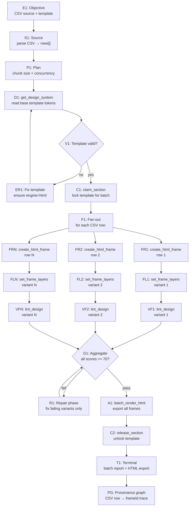

# GRAPH PLAYBOOK: CSV Batch → N Variants

> **Intent**: "Generate N design variants from a CSV data source — each row = one variant frame."
> **Graph type**: DAG (fan-out → validate → fan-in)
> **Agent scope**: IDE agent, Codex, Claude Cowork, Claude Code, Hermes, OpenClaw

---

## User Contract ("batchamator" flow) — read this FIRST

When the user says **"usa el batchamator"** (or asks for CSV-batch variants),
the flow below is MANDATORY and the SYSTEM enforces it — not the AI:

1. **Exact frame required, never guessed.** The batch tools
   (`profile_template_pool`, `generate_csv_template`, `apply_csv_to_frames`)
   accept `frameId` or `frameName` (id or human name, case-insensitive).
   - Template has **exactly one frame** → the system auto-uses it and reports
     it (`resolvedFrames[tid].autoResolved: true`). Tell the user which frame
     was used.
   - Template has **multiple frames** and no frame was specified → the system
     REJECTS the call with an error listing every frame. Your job: ask the
     user which frame, then retry with `frameId`/`frameName`.
2. **The system generates the CSV — not you.** Use `generate_csv_template` to
   produce the empty CSV skeleton (slots → columns, `_template` column
   pre-filled). You then fill it with content and hand it back via
   `apply_csv_to_frames`.
3. **Images — user intent decides, and you take it LITERALLY:**
   - User says the content is **news / articles** (or explicitly asks for
     photos) → fetch images with `search_stock_image` (Unsplash/Pexels) or from
     the source the user indicates, and put the URLs in the image columns.
   - User does **not** mention photos → leave image columns EMPTY. Empty
     cells are skipped by the system, so the original template image is kept.
     Do NOT swap, "improve", or add photos the user didn't ask for.

Related-but-different flow — **style extraction** (`extract_design_system`):
the user naming only the file → extract with NO `frameIds` (all frames,
merged); the user naming file + frame → pass `frameIds: ["<frame>"]` to
extract that frame's style only. Don't confuse the two: extraction READS
style, the batchamator WRITES variants.

---

## Schema

### Entity Types

| Type | Description | Key Fields |
|------|-------------|------------|
| `Objective` | CSV source + template intent | `csvSource`, `templateId`, `variantCount`, `targetFormats` |
| `Plan` | Fan-out strategy: sequential vs chunked | `chunkSize`, `concurrency`, `validationGate` |
| `Artifact` | One variant frame or the whole batch | `templateId`, `frameIds[]`, `variantMap{}` |
| `Run` | Single tool invocation per variant | `tool`, `params`, `duration_ms`, `rowIndex` |
| `Evaluation` | Per-variant + batch-level lint | `perVariantScores[]`, `batchScore`, `issues[]` |
| `Claim` | Lock on template during batch build | `agentId`, `templateId`, `expiresAt` |
| `Source` | CSV input, template reference | `type: "csv"`, `rows`, `columns`, `sourceHash` |

### Relation Types

| Relation | From → To | Meaning |
|----------|-----------|---------|
| `HAS_PLAN` | Objective → Plan | Batch strategy |
| `PRODUCED` | Run → Artifact | One variant frame created |
| `FAN_OUT_FROM` | Artifact → Source | Derived from CSV row N |
| `EVALUATES` | Evaluation → Artifact | Lint check on variant |
| `AGGREGATES` | Artifact → Artifact[] | Batch aggregates all variants |
| `RENDERED_BY` | Artifact → Run | batch_render_html run |

---

## Node Contract

```ts
interface BatchNode {
  id: string;
  phase: "parse" | "plan" | "fan-out" | "validate" | "repair" | "fan-in" | "terminal";
  tool: string | null;
  params: Record<string, unknown>;
  expected: Record<string, unknown>;
  on_success: string;
  on_failure: string;
  max_retries: number;
  timeout_ms: number;
  // Batch-specific
  chunkable: boolean;       // can this node run in parallel per row?
  rowIndex?: number;        // which CSV row (fan-out phase)
}
```

---

## DAG: CSV Batch → Variants



---

## Phase-by-Phase Node Guide

### Phase 1: Parse & Plan

| Node | Action | Details |
|------|--------|---------|
| E1 | Receive objective | `{ csvSource, templateId, brandName? }` |
| S1 | Parse CSV | Extract `headers[]`, `rows[][]`, compute `sourceHash` |
| P1 | Plan chunks | If rows > 10: chunk into groups of 10. Concurrency = 3-5 parallel calls. |
| D1 | `get_design_system` | `{ templateId }` → design tokens for consistent styling |
| V1 | Validate template | Has `engine === "html"`? Has at least one frame? |
| C1 | `claim_section` | `{ templateId, frameId: null, agentId, agentName }` → exclusive lock |

### Phase 2: Fan-Out (Parallel per Chunk)

| Node | Tool | Params | Expected Output |
|------|------|--------|-----------------|
| FRn | `create_html_frame` | `{ templateId, name: "Variant ${rowIndex}", width, height }` | `{ frameId, x, y }` |
| FLn | `set_frame_layers` | `{ templateId, frameId, layers }` | `{ success, layerIds[] }` |

**Variant layer population from CSV**:
```ts
function csvRowToLayers(row: string[], columns: string[], designTokens: any): EditableLayer[] {
  return columns.map((col, i) => {
    const value = row[i] || "";
    if (col === "image" || col === "image_url") {
      return { id: `img_${i}`, name: col, kind: "image", src: value, position: {...}, size: {...} };
    }
    return {
      id: `txt_${i}`, name: col, kind: "text",
      text: value,
      fontFamily: designTokens.typography.families[0] || "system-ui",
      fontSize: col === "headline" ? 48 : col === "body" ? 18 : 24,
      color: designTokens.colors.find(c => c.role === "text")?.value || "#1a1a2e",
      position: { left: col === "headline" ? 80 : 100, top: 100 + i * 80 },
      size: { width: 920, height: col === "headline" ? 120 : 60 },
    };
  });
}
```

**Concurrency strategy**:
- Chunks of 10: create frames in parallel within chunk (3-5 simultaneous calls)
- Wait for chunk to complete before next chunk
- Each frame auto-placed by `computeFramePosition` (no overlap)

### Phase 3: Per-Variant Validation

| Node | Tool | Params | Expected Output |
|------|------|--------|-----------------|
| VFn | `lint_design` | `{ templateId, frameId }` | `{ score, issues[] }` |

**Parallel safe**: Each `lint_design` call is independent → run all in parallel.

### Phase 4: Aggregate & Repair

| Gate | Check | On Fail |
|------|-------|---------|
| G1 | `all(perVariantScores >= 70)` | R1: Repair only failing variants |

**Repair strategy**:
```ts
for each variant where lintScore < 70:
  issues = lint_design(templateId, frameId).issues
  fix = generateFix(issues, variant)
  set_frame_layers(templateId, frameId, fix.layers)
  newScore = lint_design(templateId, frameId)
  if newScore <= oldScore: skip  // ratchet
```

### Phase 5: Fan-In & Export

| Node | Tool | Params | Expected Output |
|------|------|--------|-----------------|
| A1 | `batch_render_html` | `{ templateId, format: "png@2x" }` | `{ jobId, html, frames[] }` |
| C2 | `release_section` | `{ templateId, frameId: null, agentId }` | `{ success }` |

**`batch_render_html` returns**: A self-contained HTML page with all frames rendered as side-by-side previews. Save as `.html`, open in browser, fonts load, then click Download for real PNGs.

---

## Validation Contracts

### V1: Template Validity
```yaml
check: |
  Template exists AND engine === "html"
  AND (template.frames.length > 0 OR can create frames)
on_fail: |
  If engine !== "html": update_template({ id: templateId, engine: "html" })
  If no template: create_template first
```

### V2: Per-Variant Lint (G1)
```yaml
check: |
  For each variant frame i:
    score_i = lint_design({ templateId, frameId_i }).score
  batchScore = average(score_i)
  failingVariants = [i where score_i < 70]
on_fail: |
  Repair only failingVariants (not all variants)
  Ratchet: only keep fixes that improve score
  max_repair_rounds: 2 per variant
```

### V3: Data Completeness
```yaml
check: |
  variantCount === csvRows.length
  AND each variant has all columns populated
on_fail: |
  Identify missing variants
  Re-create only missing rows
  Append to existing frames (no overwrite)
```

---

## Error Recovery Paths

### ER1: CSV Parse Failure
```
Symptom: Malformed CSV, wrong encoding, BOM issues
Recovery:
  1. Try UTF-8, UTF-16, Latin-1 encodings
  2. Strip BOM character
  3. Validate column count consistency
  4. If unrecoverable: report specific line + expected columns
```

### ER2: Frame Creation Failure (mid-batch)
```
Symptom: create_html_frame fails for row N (e.g., rate limit)
Recovery:
  1. Log failed row index + error
  2. Wait 500ms
  3. Retry with exponential backoff (1s, 2s, 4s)
  4. If still fails after 3 retries: skip row, continue batch
  5. Report skipped rows in terminal
```

### ER3: Layer Rejection (editability)
```
Symptom: _editability.errors present in set_frame_layers response
Recovery:
  1. Read which layers violate flat editability
  2. Remove nested containers, flatten to siblings
  3. Ensure every layer has explicit position/left/top
  4. Retry set_frame_layers
```

### ER4: Image URL Unreachable
```
Symptom: set_frame_layers succeeds but image doesn't render
Recovery:
  1. Set placeholder background-color on image layer
  2. Log unreachable URLs in terminal report
  3. Option: use data URI fallback if image is critical
```

---

## Ratchet Loop (per variant)

```
while variant.lintScore < 70 AND rounds < 3:
  issues = lint_design(templateId, frameId).issues
  if issues.length === 0: break
  fix = generateFix(issues[0], variant)  // fix one at a time
  set_frame_layers(templateId, frameId, fix.layers)
  newScore = lint_design(templateId, frameId).score
  if newScore <= variant.lintScore: break
  variant.lintScore = newScore
  rounds++
```

---

## Terminal Report

```ts
interface BatchReport {
  objective: string;
  templateId: string;
  templateName: string;
  csvSource: string;
  csvRows: number;
  csvColumns: string[];
  csvSourceHash: string;
  variants: {
    rowIndex: number;
    frameId: string;
    frameName: string;
    lintScore: number | null;
    status: "created" | "failed" | "skipped";
    error?: string;
  }[];
  summary: {
    total: number;
    created: number;
    failed: number;
    skipped: number;
    averageLintScore: number;
  };
  exportHtml?: string;       // batch_render_html output
  editorUrl: string;
  generatedAt: string;
}
```

---

## Agent Quick-Start (Copy-Paste)

### Step 1: Parse CSV
```json
{ "method": "tools/call", "params": { "name": "list_templates", "arguments": { "workspaceId": "ws_..." } } }
```
Parse CSV locally (not an MCP tool):
```
headers = "name,headline,body,cta,image_url"
rows = [
  ["Variant A", "Summer Sale", "50% off everything", "Shop Now", "https://..."],
  ["Variant B", "New Arrivals", "Check our latest", "Explore", "https://..."],
  ...
]
```

### Step 2: Lock Template
```json
{ "method": "tools/call", "params": { "name": "claim_section", "arguments": { "templateId": "tpl_...", "frameId": null, "agentId": "csv-batch-001", "agentName": "CSV Batch Generator" } } }
```

### Step 3: Fan-Out (per chunk of 10)
```json
// For each row:
{ "method": "tools/call", "params": { "name": "create_html_frame", "arguments": { "templateId": "tpl_...", "name": "Variant A — Summer Sale", "width": 1080, "height": 1080 } } }
{ "method": "tools/call", "params": { "name": "set_frame_layers", "arguments": { "templateId": "tpl_...", "frameId": "frm_...", "layers": [...] } } }
```

### Step 4: Validate All (parallel)
```json
// For each variant frame:
{ "method": "tools/call", "params": { "name": "lint_design", "arguments": { "templateId": "tpl_...", "frameId": "frm_..." } } }
```

### Step 5: Repair Failures (ratchet)
```json
// Only for variants where score < 70:
{ "method": "tools/call", "params": { "name": "set_frame_layers", "arguments": { "templateId": "tpl_...", "frameId": "frm_...", "layers": [...fixed...] } } }
```

### Step 6: Export All
```json
{ "method": "tools/call", "params": { "name": "batch_render_html", "arguments": { "templateId": "tpl_...", "format": "png@2x" } } }
```

### Step 7: Unlock & Report
```json
{ "method": "tools/call", "params": { "name": "release_section", "arguments": { "templateId": "tpl_...", "frameId": null, "agentId": "csv-batch-001" } } }
```

---

## Principles Cross-Reference

| Graph Engineering Principle | Implementation |
|----------------------------|----------------|
| DAG as work lineage | E1→S1→P1→F1→FRn→FLn→VFn→G1→A1→T1 |
| Fan-out / fan-in | FR1..FRN parallel creation → G1 aggregate validation |
| Ratchet (only improve) | Per-variant lint loop: keep only score-improving fixes |
| Provenance | CSV row hash → frameId mapping in PG node |
| Bounded context | Each variant node receives only its row data, not full CSV |
| Evaluation at boundaries | G1 gate before export; per-variant VF before aggregate |
| Cost-aware batching | Chunks of 10 with 3-5 concurrency; exponential backoff on rate limit |
| Partial success | Skipped rows reported; batch continues despite individual failures |
| Deterministic output | Same CSV + same template = same frameIds via deterministic hashing |
