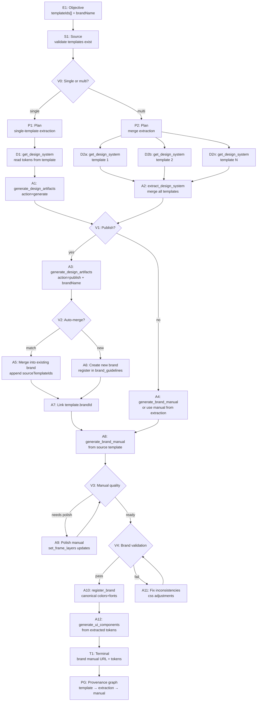

# GRAPH PLAYBOOK: Design System Extraction → Brand Manual

> **Intent**: "Extract the design system from one or more templates and generate a brand identity manual."
> **Graph type**: DAG (extract → merge → artifacts → publish)
> **Agent scope**: IDE agent, Codex, Claude Cowork, Claude Code, Hermes, OpenClaw

---

## Schema

### Entity Types

| Type | Description | Key Fields |
|------|-------------|------------|
| `Objective` | Source templates + brand identity intent | `templateIds[]`, `brandName`, `tagline?`, `workspaceId` |
| `Plan` | Extraction strategy: single vs merged | `mergeStrategy`, `publishTarget`, `artifactTypes[]` |
| `Artifact` | Extracted design system, brand manual template, tokens, CSS | `sourceHash`, `styleFingerprint`, `manualUrl` |
| `Run` | Tool invocation | `tool`, `params`, `duration_ms`, `status` |
| `Evaluation` | Lint + brand consistency check | `score`, `deltaVsOriginal`, `issues[]` |
| `Claim` | Lock on source templates during extraction | `agentId`, `templateId`, `expiresAt` |
| `Source` | Original templates being extracted from | `templateIds[]`, `frameCount`, `engine` |

### Relation Types

| Relation | From → To | Meaning |
|----------|-----------|---------|
| `EXTRACTS_FROM` | Artifact → Source | Design system derived from these templates |
| `PUBLISHES_TO` | Artifact → Artifact | Manual published as new template |
| `AUTO_MERGED_WITH` | Artifact → Artifact | Fingerprint match → merged into existing brand |
| `VALIDATES_AGAINST` | Evaluation → Artifact | Brand consistency check |
| `PARENT_OF` | Artifact → Artifact | Manual is child of extraction |

---

## Node Contract

```ts
interface ExtractionNode {
  id: string;
  phase: "source" | "extract" | "merge" | "artifacts" | "publish" | "manual" | "terminal";
  tool: string | null;
  params: Record<string, unknown>;
  expected: Record<string, unknown>;
  on_success: string;
  on_failure: string;
  max_retries: number;
  timeout_ms: number;
  // Extraction-specific
  deterministic: boolean;   // same inputs → same outputs (sourceHash)
  mergeable: boolean;        // can be merged with other extractions
}
```

---

## DAG: Extract → Brand Manual



---

## Phase-by-Phase Node Guide

### Phase 1: Source Validation

| Node | Action | Details |
|------|--------|---------|
| E1 | Receive objective | `{ templateIds: string[], brandName: string, tagline?: string, workspaceId: string }` |
| S1 | Validate | Each `templateId` exists, has `engine === "html"`, has frames with HTML/CSS |
| V0 | Decision | `templateIds.length === 1` → single path; `> 1` → merge path |

### Phase 2: Extraction

**Single-template path**:

| Node | Tool | Params | Expected Output |
|------|------|--------|-----------------|
| D1 | `get_design_system` | `{ templateId }` | `{ tokens, components, frames, brand, cssRoot }` |
| A1 | `generate_design_artifacts` | `{ templateId, action: "generate" }` | `{ sourceHash, tokensJson, designMd, sharedCss, extraction }` |

**Multi-template path**:

| Node | Tool | Params | Expected Output |
|------|------|--------|-----------------|
| D2a-n | `get_design_system` | `{ templateId: tplId_i }` | Per-template design tokens |
| A2 | `extract_design_system` | `{ templateIds: [...], name, workspaceId }` | `{ extraction (merged), artifacts, manualUrl, manualTemplateId }` |

**`extract_design_system` response shape**:
```ts
{
  templateIds: string[];
  templatesAnalyzed: number;
  totalFrames: number;
  extraction: {
    colors: { token: string; value: string; role: string; usageCount: number }[];
    typography: { families: { name: string; count: number }[]; typeScale: number[] };
    spacing: number[];
    radii: { value: string; count: number }[];
    shadows: { value: string; count: number }[];
    components: { selector: string; tag: string; frameCount: number; totalFrames: number; confidence: number; sampleHtml: string }[];
    images: string[];
    constraints: {};
    sourceHash: string;
  };
  artifacts: {
    tokensJson: string;
    designMd: string;
    sharedCss: string;
    sourceHash: string;
    styleFingerprint: string;
    generatedAt: string;
  };
  manualUrl: string | null;
  manualTemplateId: string | null;
}
```

### Phase 3: Publish & Brand Registration

| Node | Tool | Params | Expected Output |
|------|------|--------|-----------------|
| A3 | `generate_design_artifacts` | `{ templateId, action: "publish", brandName }` | `{ _published, brandId, styleFingerprint, autoMerged }` |

**Auto-merge logic** (inside A3):
- Compute `styleFingerprint` from extracted tokens
- Check existing brands in workspace for matching fingerprint
- If match → `autoMerged: true`, append `sourceTemplateIds`
- If no match → create new brand record

### Phase 4: Brand Manual Generation

| Node | Tool | Params | Expected Output |
|------|------|--------|-----------------|
| A4 | (Use manual from A2) | — | Already generated by `extract_design_system` |
| A8 | `generate_brand_manual` | `{ templateId, brandName, tagline? }` | `{ brandManualHtml, sourceHash, summary }` |

**Manual content sections** (auto-generated):
1. **Cover**: Brand name + tagline + generation date + frame count
2. **Color Palette**: Swatch cards with token name, hex value, role, usage count
3. **Typography**: Family showcase + type scale with sample text
4. **Spacing Scale**: Visual bars proportional to spacing values
5. **Border Radius**: Samples at each detected value
6. **Shadows**: Box-shadow previews
7. **Components**: Reusable components with tag, confidence, sample HTML
8. **CSS Custom Properties**: Full `:root` block with syntax highlighting

**Publishing the manual as a template**:
- `extract_design_system` auto-creates a template named `"Manual — {designName}"` with 1920×1080 frames
- Returns `manualTemplateId` and `manualUrl`
- Manual frames are pre-built with all sections as HTML content

### Phase 5: Validation & Polish

| Gate | Tool | Check | On Fail |
|------|------|-------|---------|
| V3 | Manual inspection | Are all sections populated? Colors rendered? Typos present? | A9: `set_frame_layers` or `update_html_frame` to fix |
| V4 | `validate_brand` | Template CSS matches brand tokens? Color consistency > 80%? | A11: CSS adjustments |

**`validate_brand` response**:
```ts
{
  templateId: string;
  brandId: string;
  valid: boolean;
  issues: { type: "missing_color" | "wrong_font" | "spacing_mismatch"; detail: string; severity: "error" | "warning" }[];
  score: number;
}
```

### Phase 6: Component Generation

| Node | Tool | Params | Expected Output |
|------|------|--------|-----------------|
| A12 | `generate_ui_components` | `{ templateId, components?, targetFrameId? }` | Generated UI components (button-primary, button-secondary, card, navbar, form-input, hero) |

**Default components** (if not specified): `button-primary`, `button-secondary`, `button-ghost`, `card`, `navbar`, `form-input`, `hero`

---

## Validation Contracts

### V0: Source Validity
```yaml
check: |
  For each templateId:
    template exists
    template.engine === "html"
    at least one frame has html || css
on_fail: |
  Exclude invalid templates from extraction
  If all invalid: abort with error
```

### V1: Publish Decision
```yaml
check: |
  Does user want brand stored in database?
  OR is this a one-time extraction?
on_fail: |
  Skip publish → go directly to manual generation
  Return artifacts as ephemeral response
```

### V2: Auto-Merge Detection
```yaml
check: |
  Does workspace have existing brand with matching styleFingerprint?
  Fingerprint: hash of colors + typography + spacing + radii + shadows
on_match: |
  autoMerged: true
  Append templateId to existing brand.sourceTemplateIds
  Update tokens (latest extraction wins)
on_new: |
  Create new brand_guidelines record
  Set brand.sourceTemplateIds = [templateId]
```

### V3: Manual Quality
```yaml
check: |
  Manual HTML contains all 8 sections
  Each section has content (not empty)
  Colors rendered as swatches (not just hex codes)
on_fail: |
  If section missing: truncate/extend manualFrames
  If content missing: re-run extraction with different template
```

### V4: Brand Consistency
```yaml
check: |
  validate_brand({ templateId, brandId })
  score >= 80
  No critical errors
on_fail: |
  For each missing_color: inject CSS variable
  For each wrong_font: import correct font + update font-family
  For each spacing_mismatch: normalize to brand spacing scale
```

---

## Error Recovery Paths

### ER1: No Frames with HTML/CSS
```
Symptom: "No frames with HTML/CSS content found"
Recovery:
  1. Check if template has fabric/canvas engine
  2. If fabric: export_template → convert to HTML (manual step)
  3. If engine is set but no frames: create_html_frame first
  4. Report which template is missing content
```

### ER2: Merge Conflict (Multiple Templates)
```
Symptom: Conflicting colors/typography between merged templates
Recovery:
  1. mergeExtractions() handles conflict resolution
  2. Colors: most frequent value wins
  3. Typography: union of families, median type scale
  4. If manual override needed: inform agent which tokens conflict
```

### ER3: Brand Manual Generation Fails
```
Symptom: "Manual generation failed" (non-fatal warning in extraction)
Recovery:
  1. Extraction still succeeds (manual is best-effort)
  2. Re-run generate_brand_manual separately with single template
  3. If workspaceId missing: extract from first template
  4. If createTemplate fails: manual is still returned as HTML string
```

### ER4: Auto-Merge Incorrect
```
Symptom: Two brands merged that should be separate (false positive)
Recovery:
  1. Check styleFingerprint overlap ratio
  2. If fingerprint match is coincidental: provide different brandName
  3. Manual override: delete brand record, re-publish with unique name
```

### ER5: Font Import Not Available
```
Symptom: Extracted fonts can't be rendered in manual
Recovery:
  1. Font families stored as metadata (not guaranteed to render)
  2. Manual CSS falls back to system-ui
  3. Agent can inject Google Fonts @import after extraction
```

---

## Ratchet Loop (per extraction)

```
while extraction.components.length < expectedMinimum:
  // Add more source templates to improve component detection
  additionalTemplates = list_templates({ workspaceId }).filter(t => !extracted.includes(t.id))
  if no more templates: break
  newExtraction = extract_design_system({ templateIds: [...current, additionalTemplates[0]] })
  if newExtraction.components <= extraction.components: break
  extraction = newExtraction
```

---

## Terminal Report

```ts
interface BrandExtractionReport {
  objective: string;
  brandName: string;
  tagline?: string;
  sourceTemplates: {
    templateId: string;
    name: string;
    frameCount: number;
    analyzedFrames: number;
  }[];
  extraction: {
    colors: number;
    fonts: number;
    typeScaleSizes: number;
    spacingValues: number;
    radii: number;
    shadows: number;
    components: number;
    images: number;
    sourceHash: string;
  };
  artifacts: {
    hasTokensJson: boolean;
    hasDesignMd: boolean;
    hasSharedCss: boolean;
    styleFingerprint: string;
  };
  brand: {
    brandId: string | null;
    autoMerged: boolean;
    mergedIntoBrand: string | null;
    registeredAt: string;
  } | null;
  manual: {
    manualTemplateId: string | null;
    manualUrl: string | null;
    manualHtmlAvailable: boolean;
  };
  components?: {
    generated: string[];
    count: number;
  };
  generatedAt: string;
}
```

---

## Agent Quick-Start (Copy-Paste)

### Step 1: Validate Sources
```json
{ "method": "tools/call", "params": { "name": "list_templates", "arguments": { "workspaceId": "ws_..." } } }
// Verify each templateId exists and is engine=html
```

### Step 2: Single-Template Extraction
```json
{ "method": "tools/call", "params": { "name": "generate_design_artifacts", "arguments": { "templateId": "tpl_...", "action": "generate" } } }
```

### Step 3: Multi-Template Extraction + Auto Manual
```json
{ "method": "tools/call", "params": { "name": "extract_design_system", "arguments": { "templateIds": ["tpl_a", "tpl_b"], "name": "My Brand", "workspaceId": "ws_..." } } }
// Returns: { extraction, artifacts, manualUrl, manualTemplateId }
```

### Step 4: Publish to Brand Guidelines
```json
{ "method": "tools/call", "params": { "name": "generate_design_artifacts", "arguments": { "templateId": "tpl_...", "action": "publish", "brandName": "My Brand" } } }
// Returns: { _published: true, brandId, styleFingerprint, autoMerged }
```

### Step 5: Generate Brand Manual
```json
{ "method": "tools/call", "params": { "name": "generate_brand_manual", "arguments": { "templateId": "tpl_...", "brandName": "My Brand", "tagline": "Design that speaks" } } }
// Returns: { brandManualHtml, sourceHash, summary }
```

### Step 6: Validate Brand Consistency
```json
{ "method": "tools/call", "params": { "name": "validate_brand", "arguments": { "templateId": "tpl_...", "brandId": "brand_..." } } }
```

### Step 7: Generate UI Components
```json
{ "method": "tools/call", "params": { "name": "generate_ui_components", "arguments": { "templateId": "tpl_...", "components": ["button-primary", "card", "navbar"] } } }
```

---

## Principles Cross-Reference

| Graph Engineering Principle | Implementation |
|----------------------------|----------------|
| DAG as work lineage | E1→S1→V0→P1/P2→A1/A2→V1→A3/A4→A8→T1 |
| Deterministic output | `sourceHash` + `styleFingerprint` ensure same input → same extraction |
| Provenance | TemplateIds → sourceHash → manualTemplateId trace in PG node |
| Auto-merge (ratchet on data) | Fingerprint matching prevents duplicate brands; new templates enrich existing |
| Evaluation at boundaries | V0 (validity), V1 (publish decision), V2 (auto-merge), V3 (manual quality), V4 (brand consistency) |
| Bounded context | Each node receives only needed fields; extraction doesn't dump full template content |
| Best-effort vs critical | Manual generation is best-effort (non-blocking); extraction is critical |
| Idempotent design | Same templates → same extraction → same manual; re-running is safe |
| Merge-first then refine | mergeExtractions resolves conflicts; agent polishes manual after generation |
