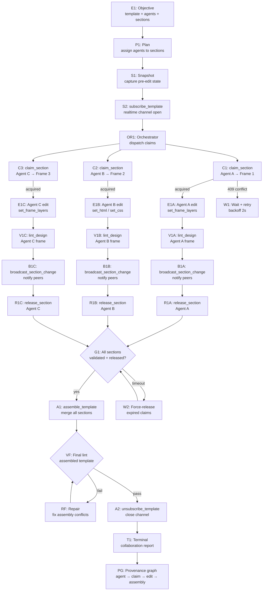

# GRAPH PLAYBOOK: Multi-Agent Collaborative Editing

> **Intent**: "Multiple AI agents collaborate on the same template — each claims a section, edits independently, then assembles."
> **Graph type**: DAG (lock-acquire → parallel-edit → release → assemble)
> **Agent scope**: IDE agent, Codex, Claude Cowork, Claude Code, Hermes, OpenClaw — any MCP-capable agent

---

## Schema

### Entity Types

| Type | Description | Key Fields |
|------|-------------|------------|
| `Objective` | Collaborative editing goal | `templateId`, `agentIds[]`, `sections[]`, `assemblyRules` |
| `Plan` | Agent-to-section assignment | `assignments: { agentId → sectionIds[] }`, `timeout_ms` |
| `Artifact` | A section (frame) or the assembled template | `frameId`, `agentId`, `layerIds[]`, `version` |
| `Run` | Agent editing action | `tool`, `params`, `agentId`, `duration_ms` |
| `Evaluation` | Per-section lint + assembly validation | `perSectionScores[]`, `assemblyScore`, `conflicts[]` |
| `Claim` | Active lock on a frame | `agentId`, `frameId`, `acquiredAt`, `expiresAt` |
| `Source` | Original template state before editing | `templateId`, `snapshotHash`, `capturedAt` |

### Relation Types

| Relation | From → To | Meaning |
|----------|-----------|---------|
| `HAS_PLAN` | Objective → Plan | Assignment strategy |
| `CLAIMS` | Claim → Artifact | Agent holds lock on this frame |
| `PRODUCED` | Run → Artifact | Agent edited this section |
| `EVALUATES` | Evaluation → Artifact | Lint check on section |
| `ASSEMBLES_INTO` | Artifact → Artifact | Section merged into final template |
| `CONFLICTS_WITH` | Artifact → Artifact | Two agents modified overlapping content |
| `SNAPSHOTTED_FROM` | Source → Artifact | Pre-edit snapshot for rollback |

---

## Node Contract

```ts
interface MultiAgentNode {
  id: string;
  phase: "orchestrate" | "snapshot" | "claim" | "edit" | "validate" | "release" | "assemble" | "terminal";
  tool: string | null;
  params: Record<string, unknown>;
  expected: Record<string, unknown>;
  on_success: string;
  on_failure: string;
  max_retries: number;
  timeout_ms: number;
  // Multi-agent specific
  agentId: string;          // which agent this node belongs to
  requiresClaim: boolean;   // must hold claim before executing?
  parallelSafe: boolean;    // can run simultaneously with other agents?
}
```

---

## DAG: Multi-Agent Collaborative Edit



---

## Phase-by-Phase Node Guide

### Phase 1: Orchestration

| Node | Action | Details |
|------|--------|---------|
| E1 | Receive objective | `{ templateId, agents: [{ id, name }], sections: [{ frameId, description }] }` |
| P1 | Plan assignments | Each agent gets 1+ frames. Non-overlapping. |
| S1 | Snapshot | `export_template({ id: templateId })` → store as rollback baseline |
| S2 | Subscribe | `subscribe_template({ templateId, channelType: "changes" })` → `{ channelId }` |

**Assignment strategy**:
```ts
function assignSections(agents: Agent[], sections: Section[]): Assignment[] {
  // Round-robin: distribute sections across agents
  return sections.map((section, i) => ({
    agentId: agents[i % agents.length].id,
    agentName: agents[i % agents.length].name,
    frameId: section.frameId,
    frameName: section.name,
    description: section.description,
  }));
}
```

### Phase 2: Claim Acquisition (Per Agent)

| Node | Tool | Params | Expected Output |
|------|------|--------|-----------------|
| Cn | `claim_section` | `{ templateId, frameId, agentId, agentName }` | `{ success: true, claim: { acquiredAt, expiresAt } }` |

**Lock semantics**:
- Each `frameId` can have at most **one** active claim
- Claim expires after TTL (server-managed)
- If already claimed → `{ code: 409, data: { claimedBy: { agentId, agentName } } }`
- On 409: wait 2s + retry up to 3 times

**`get_active_agents` for visibility**:
```json
{ "method": "tools/call", "params": { "name": "get_active_agents", "arguments": { "templateId": "tpl_..." } } }
// Returns: [{ agentId, sectionId, status: "active", startedAt }]
```

### Phase 3: Parallel Editing (Per Agent)

Each agent edits their claimed frame independently and in parallel.

| Agent | Tool | Typical Params |
|-------|------|----------------|
| A | `set_frame_layers` | `{ templateId, frameId, layers, fontImports }` |
| B | `set_html` / `set_css` | `{ templateId, frameId, html, css }` |
| C | `set_frame_layers` | `{ templateId, frameId, layers, background }` |

**Conflict prevention**:
- Agents MUST only modify their claimed frame
- `set_html`/`set_css` at template level shared — coordinate via claims with `frameId: null`
- Template-level CSS (`set_css`) is shared resource → agent claiming `frameId: null` owns it

**Realtime notifications**:
- After each edit, agent calls `broadcast_section_change`:
```json
{ "method": "tools/call", "params": { "name": "broadcast_section_change", "arguments": { "channelId": "...", "sectionId": "frm_..." } } }
```
- Other agents receive via Supabase Realtime subscription
- This enables: "Agent B sees Agent A finished → Agent B can now adapt"

### Phase 4: Per-Agent Validation

| Node | Tool | Params | Expected Output |
|------|------|--------|-----------------|
| Vn | `lint_design` | `{ templateId, frameId }` | `{ score, issues[] }` |

**Pre-release checklist** (per agent):
```
✓ lint_design score >= 70
✓ No critical issues
✓ broadcast_section_change sent
✓ Frame content matches assignment description
```

### Phase 5: Release & Assembly

| Node | Tool | Params | Expected Output |
|------|------|--------|-----------------|
| Rn | `release_section` | `{ templateId, frameId, agentId }` | `{ success }` |
| G1 | Gate | All claims released OR expired | Proceed to assemble |
| A1 | `assemble_template` | `{ templateId }` | `{ templateId, html, css }` |
| VF | `lint_design` | `{ templateId }` (all frames) | `{ score, issues[] }` |

**`assemble_template`**: Returns the merged state — all frames' HTML/CSS combined into single view. Non-destructive (read-only).

**Force-release for expired claims**:
```ts
// If an agent's claim expires before release:
// 1. get_active_agents to identify expired claims
// 2. If agent unresponsive: orchestrator calls release_section with admin override
// 3. Proceed to assemble without that agent's changes (use snapshot baseline)
```

### Phase 6: Assembly Validation & Repair

| Gate | Check | On Fail |
|------|-------|---------|
| VF | `lint_design` on assembled template → score >= 70 | RF: Identify which frame caused issue, fix selectively |

**Assembly conflict detection**:
```ts
// After assemble_template, compare:
// - CSS conflicts: two agents changed same selectors
// - Overlap: frames positioned on top of each other (x,y collision)
// - Style drift: agent A's colors don't match agent B's (check against design system)

function detectConflicts(assembled: Template, snapshot: Template): Conflict[] {
  const conflicts: Conflict[] = [];
  // CSS selector overlap
  // Frame position collision
  // Color/font inconsistency across frames
  return conflicts;
}
```

---

## Validation Contracts

### V1: Claim Validity
```yaml
check: |
  claim_section returns { success: true }
  No 409 conflict
on_fail: |
  If 409: read claimedBy from error data
  Wait 2s, retry (max 3)
  If still 409: report blocked agent + ask orchestrator
```

### V2: Section Editability
```yaml
check: |
  set_frame_layers returns { success: true }
  No _editability.errors present
on_fail: |
  Read errors[] 
  Flatten nested groups
  Add explicit position to every layer
  Retry
```

### V3: Per-Section Lint
```yaml
check: |
  lint_design({ templateId, frameId }).score >= 70
  No critical errors
on_fail: |
  Agent self-repairs before releasing claim
  Max 2 repair rounds
  If still failing: release anyway, flag in report
```

### V4: Assembly Integrity
```yaml
check: |
  All claimed frames present in assembled template
  No orphaned claims (claimed but never released)
  No frame position collisions
on_fail: |
  Remove orphaned frames
  Reposition overlapping frames
  Re-run assemble_template
```

---

## Error Recovery Paths

### ER1: Agent Unresponsive (Claim Expired)
```
Symptom: get_active_agents shows expired claim; agent not broadcasting
Recovery:
  1. Wait 2× timeout period
  2. If agent still unresponsive: orchestrator force-releases claim
  3. Restore that frame to snapshot baseline
  4. Optionally: reassign to another agent
```

### ER2: Concurrent Edit Conflict
```
Symptom: Two agents modify same CSS selector or template-level property
Recovery:
  1. Detect via assemble_template diff
  2. Last-write-wins for non-conflicting properties
  3. For conflicts: orchestrator picks winner or merges
  4. Notify both agents of resolution
```

### ER3: Frame Position Collision
```
Symptom: Two frames end up at same (x, y) after edits
Recovery:
  1. computeFramePosition with all frames to get valid positions
  2. update_html_frame({ x, y }) to reposition colliding frame
  3. Verify no new collisions created
```

### ER4: Lint Regression After Assembly
```
Symptom: Individual frames pass lint, but assembled template fails
Recovery:
  1. Isolate which frame(s) cause the issue (lint each frame)
  2. Common causes: CSS specificity clash, font import duplication, shared selector overrides
  3. Fix: namespace CSS per frame, deduplicate @import rules
```

---

## Ratchet Loop (per agent, per section)

```
while section.lintScore < 70 AND rounds < 3:
  // Agent self-improvement loop
  issues = lint_design(templateId, frameId).issues
  fix = generateFix(issues[0], section)
  set_frame_layers(templateId, frameId, fix.layers)
  broadcast_section_change(channelId, frameId)
  newScore = lint_design(templateId, frameId).score
  if newScore <= section.lintScore: break
  section.lintScore = newScore
  rounds++
```

**Global ratchet** (orchestrator):
```
while assemblyScore < lastAssemblyScore:
  // Only accept assembly if it improves overall quality
  // Not strictly enforced — agents are autonomous
  // Orchestrator can reject assembly and request re-edits
```

---

## Terminal Report

```ts
interface CollaborationReport {
  objective: string;
  templateId: string;
  templateName: string;
  preEditSnapshot: {
    hash: string;
    capturedAt: string;
    frameCount: number;
  };
  agents: {
    agentId: string;
    agentName: string;
    assignedFrames: string[];
    claimedAt: string | null;
    releasedAt: string | null;
    status: "completed" | "timeout" | "conflict" | "unresponsive";
    editsApplied: number;
    broadcastCount: number;
    lintScore: number | null;
    errors: string[];
  }[];
  assembly: {
    totalFrames: number;
    assembledAt: string;
    assemblyLintScore: number | null;
    conflicts: {
      type: "css_conflict" | "position_collision" | "style_drift";
      frames: string[];
      resolution: string;
    }[];
  };
  finalLintScore: number | null;
  editorUrl: string;
  generatedAt: string;
}
```

---

## Agent Quick-Start (Copy-Paste)

### Step 1: Orchestrator — Subscribe
```json
{ "method": "tools/call", "params": { "name": "subscribe_template", "arguments": { "templateId": "tpl_...", "channelType": "changes" } } }
// Returns: { channelId: "template:tpl_...:changes" }
```

### Step 2: Each Agent — Claim Section
```json
{ "method": "tools/call", "params": { "name": "claim_section", "arguments": { "templateId": "tpl_...", "frameId": "frm_hero", "agentId": "agent-alpha", "agentName": "Alpha Designer" } } }
// Returns: { success: true, claim: { acquiredAt, expiresAt } }
```

### Step 3: Each Agent — Edit
```json
{ "method": "tools/call", "params": { "name": "set_frame_layers", "arguments": { "templateId": "tpl_...", "frameId": "frm_hero", "layers": [...] } } }
```

### Step 4: Each Agent — Validate & Broadcast
```json
{ "method": "tools/call", "params": { "name": "lint_design", "arguments": { "templateId": "tpl_...", "frameId": "frm_hero" } } }
{ "method": "tools/call", "params": { "name": "broadcast_section_change", "arguments": { "channelId": "template:tpl_...:changes", "sectionId": "frm_hero" } } }
```

### Step 5: Each Agent — Release
```json
{ "method": "tools/call", "params": { "name": "release_section", "arguments": { "templateId": "tpl_...", "frameId": "frm_hero", "agentId": "agent-alpha" } } }
```

### Step 6: Orchestrator — Check Active Agents
```json
{ "method": "tools/call", "params": { "name": "get_active_agents", "arguments": { "templateId": "tpl_..." } } }
// Wait until all agents released
```

### Step 7: Orchestrator — Assemble & Final Lint
```json
{ "method": "tools/call", "params": { "name": "assemble_template", "arguments": { "templateId": "tpl_..." } } }
{ "method": "tools/call", "params": { "name": "lint_design", "arguments": { "templateId": "tpl_..." } } }
{ "method": "tools/call", "params": { "name": "unsubscribe_template", "arguments": { "templateId": "tpl_...", "channelType": "changes" } } }
```

---

## Principles Cross-Reference

| Graph Engineering Principle | Implementation |
|----------------------------|----------------|
| DAG as work lineage | E1→P1→S1→Cn→En→Vn→Bn→Rn→G1→A1→VF→T1 |
| Parallel-safe fan-out | Agents C1-C3 claim and edit simultaneously; no shared state |
| Claim-based concurrency | `claim_section` enforces exclusive access per frame; 409 on conflict |
| Ratchet (only improve) | Per-agent lint loop; assembler rejects if global score drops |
| Provenance | PG node maps agent→claim→edit→broadcast→release→assembly |
| Bounded context | Each agent sees only assigned frames + design system; no raw template dump |
| Evaluation at boundaries | V1 (claim), V2 (editability), V3 (per-section lint), V4 (assembly) |
| Graceful degradation | Expired claims → force-release + snapshot restore; unresponsive agents don't block |
| Realtime transparency | `subscribe_template` + `broadcast_section_change` + `get_active_agents` for visibility |
| Rollback safety | Pre-edit snapshot via `export_template`; restore on critical failure |
