# Playbook: Replicate HTML+CSS → Frame → Multi-Format Adaptation

> **Type:** Agent Playbook (Graph-Grounded Workflow)
> **Protocol:** MCP JSON-RPC 2.0 via `POST /mcp`
> **Endpoint:** `https://design.futuraria.com/mcp`
> **Auth:** `x-api-key: fdr_ws_<key>` (from dashboard Settings → Security)
> **Principle:** Every output traces to an objective, a plan, an artifact, a source, a graph path, an evaluator decision, and a bounded execution record.

---

## 1. Schema: Entity Types, Relations, and Node Contracts

### 1.1 Entity Types

| Entity | Fields | Description |
|--------|--------|-------------|
| `Objective` | `id, description, user_input_html, user_input_css, template_name_hint, target_formats[], created_at` | The user's request |
| `Plan` | `id, objective_id, steps[{id, action, tool, params, depends_on[], success_criteria}]` | Ordered task graph |
| `Artifact` | `id, run_id, type("template"\|"frame"\|"adaptation"), content_hash, version, created_at` | Any created/modified entity |
| `Run` | `id, objective_id, agent_id, started_at, finished_at, status, token_cost, errors[]` | One agent execution |
| `Evaluation` | `id, artifact_id, rubric_id, passed, checks[{rule, passed, expected, actual}]` | Validation result |
| `Claim` | `id, run_id, statement, evidence_edge_ids[], confidence` | Assertion about an artifact |
| `Source` | `id, type("user_input"\|"mcp_response"\|"tool_output"), content_hash, raw_preview` | Provenance origin |

### 1.2 Relation Types

| Relation | From → To | Meaning |
|----------|-----------|---------|
| `HAS_PLAN` | `Objective` → `Plan` | Objective decomposes into plan |
| `PRODUCED` | `Run` → `Artifact` | Run created this artifact |
| `EVALUATES` | `Evaluation` → `Artifact` | Evaluation judges artifact |
| `SUPPORTS` | `Source` → `Claim` | Source backs this claim |
| `PARENT_OF` | `Artifact(v1)` → `Artifact(v2)` | Version lineage |
| `ADAPTED_FROM` | `Artifact(adaptation)` → `Artifact(source_frame)` | Format adaptation lineage |
| `DEPENDS_ON` | `Step` → `Step` | Step ordering constraint |
| `CONTAINS` | `Artifact(template)` → `Artifact(frame)` | Template owns frame |

### 1.3 Node Contract (Every Action Node)

```typescript
interface ActionNode {
  id: string;                    // e.g. "find_template"
  type: "action";
  tool: string;                  // MCP tool name
  params: Record<string, any>;   // input
  expected: {                    // success shape
    status: "ok" | "partial";
    shape: Record<string, string>; // key → type
  };
  on_success: string;            // next node ID
  on_failure: {                  // error recovery
    patterns: Record<string, string>; // error message → next node ID
    default: string;             // fallback node
  };
  max_retries: number;
  timeout_ms: number;
}
```

---

## 2. The DAG: Replicate HTML+CSS → Frame → Multi-Format

```mermaid
graph TB
    %% ═══════════════ ENTRY ═══════════════
    E1["entry: receive_objective<br/>user provides HTML+CSS + template name hint"]

    %% ═══════════════ PHASE 1: DISCOVERY ═══════════════
    E1 --> D1{"decision: auth_valid?"}
    D1 -->|"no key"| A1["action: ask_user_for_key"]
    A1 --> D1
    D1 -->|"yes"| A2["action: list_workspaces<br/>tool: list_workspaces"]

    A2 --> V1{"validate: workspaces > 0?"}
    V1 -->|"no"| A3["action: create_workspace<br/>tool: create_workspace"]
    A3 --> A4["action: create_template<br/>tool: create_template{engine:'html'}"]
    A4 --> A5["action: create_html_frame + set_html/set_css"]
    A5 --> P3["phase: adapt_formats"]

    V1 -->|"yes"| A6["action: list_templates<br/>tool: list_templates{workspaceId, search}"]

    A6 --> D2{"decision: template found?"}
    D2 -->|"no"| A3
    D2 -->|"multiple matches"| A7["action: ask_user_choose<br/>present top 5 matches by updatedAt"]
    A7 --> A8["action: get_template<br/>tool: get_template{templateId}"]

    D2 -->|"exact match"| A8

    %% ═══════════════ PHASE 2: FRAME CREATION ═══════════════
    A8 --> A9["action: list_frames<br/>tool: list_frames{templateId}"]
    A9 --> V2{"validate: existing frames?"}
    V2 -->|"0 frames"| A10["action: set_html + set_css<br/>directly on frame 1<br/>tool: set_html + set_css{frameId: frame1.id}"]
    V2 -->|"1+ frames"| A11["action: create_html_frame<br/>tool: create_html_frame{templateId, name, html, css}"]
    A11 --> A12["action: set_html<br/>tool: set_html{templateId, frameId}"]
    A12 --> A13["action: set_css<br/>tool: set_css{templateId, frameId}"]

    A10 --> V3{"validate: frame has html + css?"}
    A13 --> V3

    V3 -->|"no"| A14["loop: retry set_html/set_css<br/>max_retries=3"]
    A14 --> V3

    V3 -->|"yes"| A15["action: get_template<br/>verify frame position non-overlapping"]

    %% ═══════════════ PHASE 3: FORMAT ADAPTATION ═══════════════
    P3["phase: adapt_formats"]
    A15 --> D3{"decision: which formats?"}

    D3 -->|"story"| F1["action: adapt_format<br/>tool: adapt_format{targetFormat:{name:'story',w:1080,h:1920}}"]
    D3 -->|"post"| F2["action: adapt_format<br/>tool: adapt_format{targetFormat:{name:'post',w:1080,h:1080}}"]
    D3 -->|"linkedin"| F3["action: adapt_format<br/>tool: adapt_format{targetFormat:{name:'linkedin',w:1200,h:627}}"]
    D3 -->|"all"| F4["action: adapt_all_formats<br/>tool: adapt_all_formats{formats:[story,post,linkedin]}"]

    F1 --> F5["action: set_html + set_css<br/>on each adaptation template"]
    F2 --> F5
    F3 --> F5
    F4 --> F5

    F5 --> V4{"validate: all adaptations have html?"}
    V4 -->|"no"| A16["loop: retry per-format<br/>max_retries=2 each"]
    A16 --> V4

    V4 -->|"yes"| T1["terminal: report_results<br/>return all templateIds + editorUrls"]

    %% ═══════════════ STYLING ═══════════════
    classDef entry fill:#1a1a2e,stroke:#e94560,color:#eee,stroke-width:3px
    classDef decision fill:#16213e,stroke:#0f3460,color:#eee
    classDef action fill:#0f3460,stroke:#533483,color:#eee
    classDef validate fill:#533483,stroke:#e94560,color:#eee
    classDef terminal fill:#1a1a2e,stroke:#00ff88,color:#eee,stroke-width:3px
    classDef phase fill:#16213e,stroke:#e94560,color:#eee,stroke-dasharray:5

    class E1 entry
    class D1,D2,D3 decision
    class A1,A2,A3,A4,A5,A6,A7,A8,A9,A10,A11,A12,A13,A14,A15,A16,F1,F2,F3,F4,F5 action
    class V1,V2,V3,V4 validate
    class T1 terminal
    class P3 phase
```



---

## 3. Node-by-Node Guide (Machine-Executable)

### Phase 0: Auth Bootstrap

| Node | Tool | Params | Expected | On Failure |
|------|------|--------|----------|------------|
| `D1` | — | Check `x-api-key` header present | — | If missing, ask user: "Provide API key from Settings → Security" |
| `A1` | — | Prompt user for `fdr_ws_*` key | User provides key | Retry D1 |
| `A2` | `list_workspaces` | `{}` | `{ data: [{ id, name }], total }` | If 401 → D1 (key invalid). If 0 results → A3 |

### Phase 1: Template Discovery

| Node | Tool | Params | Expected | On Failure |
|------|------|--------|----------|------------|
| `A3` | `create_workspace` | `{ name: "<from user context>" }` | `{ id }` | Ask user for workspace name |
| `A4` | `create_template` | `{ name, workspaceId, engine: "html", width: 1080, height: 1080 }` | `{ id, frames: [{ id }] }` | Retry once. If still fails → abort, report error |
| `A6` | `list_templates` | `{ workspaceId, search: "<template name hint>", limit: 20 }` | `{ data: [{ id, name }], total }` | If empty → A3. If 401 → D1 |
| `A7` | — | Present matches to user; user selects one | `templateId` | If user says "none of these" → A3 |
| `A8` | `get_template` | `{ templateId }` | `{ id, name, frames: [{ id, name, x, y, width, height, html, css }], _frameCount }` | If 404 → A6 retry with broader search |

### Phase 2: Non-Overlapping Frame Creation

| Node | Tool | Params | Expected | On Failure |
|------|------|--------|----------|------------|
| `A9` | `list_frames` | `{ templateId }` | `{ frames: [{ id, name, x, y, width, height }], total }` | If 0 → A10 (use frame 1 directly) |
| `A11` | `create_html_frame` | `{ templateId, name: "<descriptive>", html: "<user HTML>", css: "<user CSS>" }` | `{ id, x, y, width, height, _editability }` | If `width`/`height` mismatch with user content → detect dimensions from CSS and retry with explicit `width`/`height` |
| `A12` | `set_html` | `{ templateId, frameId: "<from A11>", html: "<user HTML>" }` | `{ success: true, htmlLength }` | Retry up to 3 times. If DOMPurify strips content → log warning, proceed |
| `A13` | `set_css` | `{ templateId, frameId: "<from A11>", css: "<user CSS>" }` | `{ success: true, cssLength }` | Retry up to 3 times |
| `A15` | `get_template` | `{ templateId }` | Verify `frame.x, frame.y` are unique (no overlap with other frames) | If overlap detected → delete frame, retry A11 with explicit `width`/`height` |

**Auto-placement guarantee:** `create_html_frame` uses cascade-grid algorithm:
- Row width max: 4000px
- Gap between frames: 100px
- Auto-wraps to new row when row full
- **System-enforced: never overlaps existing frames**

### Phase 3: Format Adaptation

| Node | Tool | Params | Expected | On Failure |
|------|------|--------|----------|------------|
| `F1` | `adapt_format` | `{ templateId, targetFormat: { name: "story", width: 1080, height: 1920 } }` | `{ newTemplateId, width: 1080, height: 1920 }` | If fails → create template manually + set_html/set_css |
| `F2` | `adapt_format` | `{ templateId, targetFormat: { name: "post", width: 1080, height: 1080 } }` | `{ newTemplateId }` | Same recovery as F1 |
| `F3` | `adapt_format` | `{ templateId, targetFormat: { name: "linkedin", width: 1200, height: 627 } }` | `{ newTemplateId }` | Same recovery as F1 |
| `F4` | `adapt_all_formats` | `{ templateId, formats: [{ name: "story", width: 1080, height: 1920 }, { name: "post", width: 1080, height: 1080 }, { name: "linkedin", width: 1200, height: 627 }] }` | `{ results: [{ format, templateId }] }` | If partial success → report which formats succeeded/failed |
| `F5` | `set_html` + `set_css` | For each adaptation `templateId`: apply user's HTML/CSS (may need responsive adjustments) | Each returns `{ success: true }` | Skip failed adaptations, report in final summary |

**Format dimension reference:**

| Format | Width | Height | Aspect |
|--------|-------|--------|--------|
| Instagram Story | 1080 | 1920 | 9:16 |
| Instagram Post (square) | 1080 | 1080 | 1:1 |
| Instagram Post (portrait) | 1080 | 1350 | 4:5 |
| LinkedIn Post | 1200 | 627 | 1.91:1 |
| LinkedIn Square | 1200 | 1200 | 1:1 |
| Facebook Post | 1200 | 630 | 1.91:1 |
| Twitter/X Post | 1200 | 675 | 16:9 |

---

## 4. Validation Contracts (Evaluation Nodes)

### V1: Workspace Exists
```typescript
{
  check: "workspaces.length > 0",
  on_pass: "A6 (list templates)",
  on_fail: "A3 (create workspace + template)",
  evidence: "list_workspaces response"
}
```

### V2: Existing Frames
```typescript
{
  check: "frames.length > 0",
  on_pass: "A11 (create_html_frame — auto-positioned, non-overlapping)",
  on_fail: "A10 (set_html/set_css directly on default frame 1)",
  evidence: "list_frames response"
}
```

### V3: Frame Content Integrity
```typescript
{
  checks: [
    { rule: "html_length > 0", severity: "error" },
    { rule: "css_length > 0", severity: "warning" },
    { rule: "frame.position_unique", severity: "error", 
      check: "no two frames share overlapping x/y bounds" }
  ],
  on_any_fail: "A14 (retry loop, max 3)",
  on_pass: "P3 (adapt formats)",
  evidence: "get_template response after set_html/set_css"
}
```

### V4: Adaptation Completeness
```typescript
{
  checks: [
    { rule: "all_requested_formats_have_templateId", severity: "error" },
    { rule: "each_adaptation_has_html", severity: "error" },
    { rule: "adaptation_dimensions_match_target", severity: "warning" }
  ],
  on_any_fail: "A16 (per-format retry, max 2 each)",
  on_pass: "T1 (terminal report)",
  evidence: "adapt_format/adapt_all_formats responses + get_template per adaptation"
}
```

---

## 5. Error Recovery Paths

### Auth Failure (401)
```
D1 → A1 (ask user for key) → D1
Max cycles: 3, then abort with "Cannot authenticate. Verify API key in Settings → Security."
```

### Template Not Found
```
D2 → A3 (create workspace) → A4 (create template) → A5 (create frame)
Rationale: if user says "the file already exists" but search fails, create it fresh.
```

### Frame Overlap Detected
```
V3 fail → delete conflicting frame via update_template → A11 (recreate with explicit dimensions)
Max cycles: 2
```

### Adaptation Partial Failure
```
F5 → per-format retry (A16) → report { succeeded: [...], failed: [{format, reason}] }
Never block successful formats for one failure.
```

---

## 6. Ratchet Loop (Quality Gate)

```
FOR EACH frame created:
  1. Read frame HTML/CSS from get_template
  2. Hash content → content_hash
  3. Verify: html_length > 0 AND css_length > 0
  4. Verify: frame position does not overlap any sibling frame
  5. If checks pass → KEEP frame, record in run history
  6. If checks fail → DELETE frame, retry creation (max 2)
  
FOR EACH format adaptation:
  1. Verify newTemplateId exists
  2. Verify dimensions match target format
  3. Apply HTML/CSS
  4. Verify content integrity
  5. If passes → KEEP adaptation
  6. If fails → mark as partial, continue with remaining formats
```

---

## 7. Terminal Report (T1)

```typescript
interface RunReport {
  objective_id: string;
  run_id: string;
  agent_id: string;
  status: "complete" | "partial" | "failed";
  artifacts: {
    source_template: { id: string; name: string; editorUrl: string };
    new_frame: { id: string; name: string; position: { x: number; y: number } };
    adaptations: Array<{
      format: string;
      templateId: string;
      editorUrl: string;
      status: "ok" | "failed";
      error?: string;
    }>;
  };
  evaluations: Array<{ artifact_id: string; passed: boolean; checks: any[] }>;
  token_cost: number;
  duration_ms: number;
  errors: string[];
  editor_urls: string[];  // direct links for user
}
```

---

## 8. Provenance Graph (Post-Run)

```
(user_input_html_css)               → SOURCE
  └── SUPPORTS → (claim: design_replicated)
                    └── PRODUCED_BY → (run_id)
                                        ├── PRODUCED → (artifact: template)
                                        │                 ├── CONTAINS → (artifact: frame_N)
                                        │                 └── ADAPTED_FROM → (artifact: story_adaptation)
                                        │                                       └── PARENT_OF → (artifact: story_adaptation_v2)
                                        ├── PRODUCED → (artifact: post_adaptation)
                                        └── PRODUCED → (artifact: linkedin_adaptation)

(evaluation: frame_integrity)        → EVALUATES → (artifact: frame_N)
(evaluation: adaptation_completeness)→ EVALUATES → (artifact: story_adaptation)
```

---

## 9. Agent Quick-Start (Copy-Paste Playbook)

```
OBJECTIVE: Replicate HTML+CSS into {template_name}, add as non-overlapping frame, adapt to story/post/linkedin.

STEP 0 — Auth
  POST /mcp { method: "tools/call", params: { name: "list_workspaces", arguments: {} } }
  Header: x-api-key: fdr_ws_<your-key>
  IF 401 → ask user for key. IF 0 workspaces → create one.

STEP 1 — Find template
  POST /mcp { method: "tools/call", params: { name: "list_templates", arguments: { workspaceId: "<wsId>", search: "{template_name}" } } }
  IF 0 results → create_template({ name: "{template_name}", workspaceId, engine: "html" })
  IF 1 result → use that templateId
  IF 2+ results → ask user to pick, then get_template({ templateId })

STEP 2 — Check existing frames
  POST /mcp { method: "tools/call", params: { name: "list_frames", arguments: { templateId } } }
  IF 0 frames → use frame 1 from template creation, go to STEP 3
  IF 1+ frames → create_html_frame (auto-positioned, never overlaps)

STEP 3 — Create non-overlapping frame
  POST /mcp { method: "tools/call", params: { name: "create_html_frame", arguments: {
    templateId, name: "{descriptive name}",
    html: "{user's HTML}", css: "{user's CSS}"
  } } }
  → Returns { id: frameId, x, y, width, height }
  → x/y are auto-calculated: cascade grid, 100px gap, max 4000px row width

STEP 4 — Verify frame
  POST /mcp { method: "tools/call", params: { name: "get_template", arguments: { templateId } } }
  Check: frame.html.length > 0 AND frame position unique among siblings

STEP 5 — Adapt to formats
  POST /mcp { method: "tools/call", params: { name: "adapt_all_formats", arguments: {
    templateId,
    formats: [
      { name: "story", width: 1080, height: 1920 },
      { name: "post", width: 1080, height: 1080 },
      { name: "linkedin", width: 1200, height: 627 }
    ]
  } } }
  → Returns { results: [{ format, templateId }] }

STEP 6 — Apply HTML/CSS to each adaptation
  FOR EACH adaptation:
    POST /mcp { method: "tools/call", params: { name: "set_html", arguments: { templateId: adaptation.templateId, html: "{user HTML}" } } }
    POST /mcp { method: "tools/call", params: { name: "set_css", arguments: { templateId: adaptation.templateId, css: "{user CSS}" } } }

STEP 7 — Report
  Return all templateIds with editor URLs:
  https://design.futuraria.com/editor/{templateId}
```

---

## 10. Graph Engineering Principles Applied

| Principle | Implementation |
|-----------|---------------|
| **Loop (ratchet)** | V3→A14→V3: retry frame creation up to 3 times, only keep successful frames |
| **DAG (work lineage)** | Every frame is `PARENT_OF` its adaptations. Every evaluation nodes to the artifact it judges |
| **Shared memory (graph)** | `Objective → Plan → Run → Artifact(s) → Evaluation` — agents traverse, don't copy context |
| **Provenance** | Every claim (`design_replicated`) links to `Source` (user input) and `Run` (which agent produced it) |
| **Reversibility** | Failed frames are deleted via `update_template`; Git-style revert at frame level |
| **Bounded context** | Each step has typed input/output contract; no transcript dumping |
| **Evaluation gate** | V1-V4 block progression until checks pass; never proceed with corrupt state |
| **Budget awareness** | `max_retries`, `timeout_ms`, `token_cost` tracked per node |
| **Grounding** | Every adaptation `ADAPTED_FROM` its source frame; evaluator checks dimension match |

---

> **Maintainer note:** When new MCP tools are added (e.g., responsive CSS adaptation, semantic slot detection), add them as new action nodes branching from P3. Each new node inherits the validation contract pattern: `{ check, on_pass, on_fail, evidence }`.
