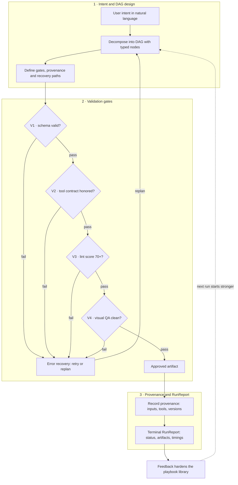

# Musa — Graph Engineering Loop

<!-- GraphForge live mirror. This mermaid block is the single source of truth.
     Node positions persist in `%% @pos id x y` comments, drill-downs in `%% @link id graph-name`. Edit by hand or by AI: -->

